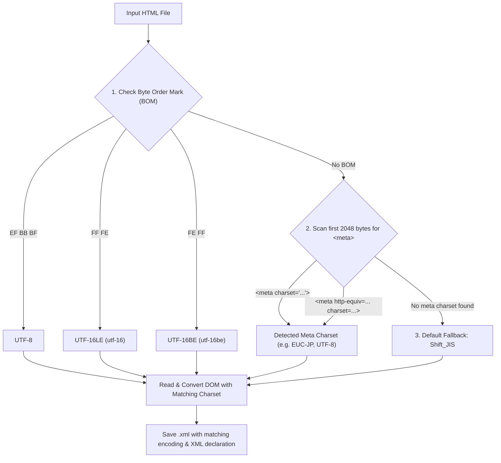

# html2xml.vbs - Drag-and-Drop HTML to XML Converter

A lightweight, standalone Windows VBScript tool that converts arbitrary HTML files (including loose, unclosed, or legacy HTML) into well-formed, standards-compliant XML documents.

Designed specifically for Windows environments, `html2xml.vbs` operates with **zero external dependencies or third-party installations**, relying entirely on native Windows COM components. It features seamless Windows Explorer drag-and-drop support, robust multi-encoding detection with Japanese `Shift_JIS` default fallback, and resilient DOM tree normalization.

---

## Key Features

- **Pure VBScript / Zero External Dependencies**: Runs out-of-the-box on any modern Windows system using built-in Windows Script Host (`wscript.exe` / `cscript.exe`).
- **Drag-and-Drop Batch Processing**: Drag one or multiple `.html` / `.htm` files onto `html2xml.vbs` in Windows Explorer to convert them instantly.
- **Fault-Tolerant HTML Parsing**: Leverages the Trident/MSHTML parsing engine (`htmlfile`) to ingest poorly-formed HTML, unbalanced tags, and legacy markup.
- **Strict XML Serialization**: Uses `MSXML2.DOMDocument` to reconstruct a normalized, well-formed XML DOM where all tags (including HTML void tags like `<br>`, ``, `<hr>`, `<input>`) are properly closed.
- **Smart Encoding Detection & Preservation**:
  1. Inspects Byte Order Marks (BOM) for UTF-8, UTF-16LE, and UTF-16BE.
  2. Inspects `<meta>` charset declarations (`<meta charset="...">` and `<meta http-equiv="Content-Type" content="...; charset=...">`).
  3. Defaults gracefully to Japanese **`Shift_JIS`** (Code Page 932) when no encoding signature is present.
  4. Preserves matching encoding in both the output byte stream and the `<?xml version="1.0" encoding="..."?>` declaration.
- **XML Identifier Sanitization & Entity Escaping**:
  - Sanitizes invalid element/attribute names and handles namespace colon collisions.
  - Automatically escapes reserved XML entities (`<`, `>`, `&`, `"`, `'`).
  - Normalizes XML comment syntax (`--` is converted to `- -` to avoid XML comment syntax violations).
- **Clear Progress & Diagnostics**: Displays an interactive summary dialog (`MsgBox`) showing counts of succeeded, failed, and skipped files, with specific error details.

---

## System Requirements

- **Operating System**: Windows 7 / 8 / 10 / 11 or Windows Server 2008 R2+.
- **Runtime**: Windows Script Host (WSH), pre-installed on all standard Windows editions.
- **Components**: Standard Windows COM libraries:
  - `htmlfile` (Microsoft HTML Object Library / MSHTML)
  - `MSXML2.DOMDocument.6.0` (or `MSXML2.DOMDocument`)
  - `ADODB.Stream` (ActiveX Data Objects)
  - `Scripting.FileSystemObject`

---

## How to Use

### Method 1: Drag-and-Drop (Recommended for Everyday Use)

1. Locate `html2xml.vbs` in Windows Explorer.
2. Select one or more `.html` or `.htm` files in any folder.
3. Drag the selected files and drop them directly onto `html2xml.vbs` (or a desktop shortcut to it).
4. The script converts each file sequentially and displays a summary dialog upon completion:
   ```text
   HTML 转 XML 处理完成！

   成功: 2 个
   失败: 0 个
   跳过: 0 个

   明细:
   [成功] index.html -> index.xml (utf-8)
   [成功] report.html -> report.xml (shift_jis)
   ```

### Method 2: Command-Line (CLI / Batch Scripting)

You can run `html2xml.vbs` via `cscript.exe` (console mode) or `wscript.exe` (windowed mode):

```cmd
:: Using cscript in Command Prompt or PowerShell:
cscript //nologo html2xml.vbs "C:\path\to\file1.html" "C:\path\to\file2.htm"

:: Or using wscript:
wscript html2xml.vbs "C:\path\to\file1.html"
```

> [!TIP]
> Use `cscript` when invoking the tool inside batch scripts (`.bat`) or automation pipelines.

### Method 3: Direct Launch / Help Guide

If you double-click `html2xml.vbs` directly without passing any file arguments, a help dialog appears detailing how to use the script:

```text
Please drag and drop HTML file(s) onto this script icon to convert.

Usage instructions:
1. Supports dragging single or multiple .html / .htm files;
2. Automatically detects source file encoding (defaults to Shift_JIS when unstated);
3. Converted .xml files will be saved in the same directory as the source files.
```

---

## Output Location & Naming

Converted `.xml` files are **always saved in the exact same directory as the source HTML file**, preserving the original file base name:

| Source File Path | Target Output Path |
| :--- | :--- |
| `D:\projects\docs\index.html` | `D:\projects\docs\index.xml` |
| `C:\data\manual.htm` | `C:\data\manual.xml` |
| `E:\files\2026_report.HTML` | `E:\files\2026_report.xml` |

- If an output file already exists, it is overwritten with the newly generated XML content.
- Folders and non-HTML files dropped onto the script are automatically skipped and noted in the final summary report.

---

## Encoding Handling

HTML documents in legacy and international projects often mix UTF-8 with regional encodings such as Shift_JIS without explicit declarations. `html2xml.vbs` applies a strict three-tier detection strategy:



### Detection Hierarchy

1. **Byte Order Mark (BOM)**:
   - Evaluates the initial binary bytes using `ADODB.Stream`.
   - `EF BB BF` -> `utf-8`
   - `FF FE` -> `utf-16` (UTF-16LE)
   - `FE FF` -> `utf-16be` (UTF-16BE)
2. **HTML `<meta>` Tag Inspection**:
   - Reads the initial 2048 bytes using single-byte stream (`iso-8859-1`) to avoid corrupting text pointers.
   - Evaluates regular expressions for both HTML5 and HTML4 forms:
     - HTML5: `<meta[^>]+charset=["']?([a-zA-Z0-9_\-]+)`
     - HTML4: `<meta[^>]+content=["'][^"']*charset=([a-zA-Z0-9_\-]+)`
3. **Default Fallback**:
   - If neither a BOM nor a `<meta>` charset tag is found, the script defaults to **`shift_jis`** (Japanese Windows ANSI Code Page 932).

### Encoding Consistency in Output

`html2xml.vbs` guarantees full consistency between the XML declaration and the physical file encoding:
- The XML processing instruction explicitly sets: `<?xml version="1.0" encoding="<detected_charset>"?>`.
- The output file is written via `ADODB.Stream` configured with the exact same charset.

---

## DOM Normalization & XML Compliance

Standard HTML is forgiving of unclosed tags and invalid characters, whereas XML requires strict well-formedness. `html2xml.vbs` resolves HTML discrepancies automatically:

### 1. Void Tag Auto-Closure
HTML void elements that lack closing tags (e.g., `<br>`, ``, `<hr>`, `<input>`, `<link>`, `<meta>`) are parsed by MSHTML into the DOM and serialized into self-closing XML tags:
```html
<!-- Input HTML -->
Line 1<br>Line 2<hr><input type="text" value="hello">
```
```xml
<!-- Output XML -->
<p>Line 1<br/>Line 2<hr/><input type="text" value="hello"/></p>
```

### 2. Element & Attribute Name Sanitization
- Replaces invalid XML tag and attribute characters with compliant characters.
- Prefixes identifiers starting with digits or invalid characters with `_` (e.g. `<123tag>` becomes `<_123tag>`).
- If an undeclared namespace prefix (such as `o:p` or `v:shape`) is encountered, the script cleanses or replaces `:` with `_` (e.g. `o_p`) to prevent MSXML DOM namespace resolution errors.

### 3. Attribute & Style Preservation
- Preserves all element attributes where `specified = True`.
- Extracts dynamic or inline CSS styling via `child.style.cssText` so CSS rules are retained intact on the `style` attribute.

### 4. Text & Comment Escaping
- Text nodes are created via `xmlDoc.createTextNode()`, ensuring automatic XML escaping for `<`, `>`, `&`, `"`, and `'`.
- Comment nodes are scrubbed according to XML 1.0 rules: consecutive hyphens (`--`) within comments are replaced with `- -`, and trailing hyphens before `-->` are padded with a space.

---

## Troubleshooting & FAQ

### Q1: Double-clicking or dragging files opens Notepad or another editor instead of running the script.
**Reason**: The `.vbs` file extension is associated with a text editor (e.g., VS Code, Notepad++, or Notepad) on your Windows machine.  
**Solution**:
1. Right-click `html2xml.vbs` -> **Open with** -> **Choose another app**.
2. Select **Microsoft (R) Windows Based Script Host** (`wscript.exe`, typically located at `C:\Windows\System32\wscript.exe`).
3. Check the box **"Always use this app to open .vbs files"**.
4. Alternatively, execute via Command Prompt:
   ```cmd
   wscript.exe "C:\path\to\html2xml.vbs" "C:\path\to\file.html"
   ```

---

### Q2: Windows Defender or Antivirus blocks the script or shows a SmartScreen warning.
**Reason**: Modern Windows systems flag `.vbs` scripts downloaded from the internet with the "Mark of the Web" (Zone.Identifier).  
**Solution**:
1. Right-click `html2xml.vbs` -> **Properties**.
2. At the bottom of the **General** tab, check the **Unblock** checkbox.
3. Click **Apply** and **OK**.

---

### Q3: When dragging a very large number of files (e.g. > 100), some are not processed.
**Reason**: Windows Explorer imposes a character length limit (~2048 to 8192 characters) on command-line arguments generated during drag-and-drop operations.  
**Solution**:
- Drag files in smaller batches (e.g., 20–30 files at a time).
- Alternatively, run a one-line command in Command Prompt to process all files in a folder without length restrictions:
  ```cmd
  for %F in (*.html *.htm) do @cscript //nologo html2xml.vbs "%~fF"
  ```

---

### Q4: Japanese or non-ASCII characters appear as question marks or mojibake (文字化け).
**Reason**: The HTML file might be saved in an encoding that disagrees with its internal `<meta>` tag (e.g., a file encoded in UTF-8 that contains a `<meta charset="shift_jis">` declaration, or vice-versa).  
**Solution**:
- Check the file's encoding in an editor like VS Code or Notepad++.
- If the file is UTF-8 without a BOM or meta tag, add `<meta charset="utf-8">` to the `<head>` section, or save it with UTF-8 BOM so `html2xml.vbs` will detect it automatically.

---

### Q5: Can I drag entire folders onto the script?
**Answer**: Currently, `html2xml.vbs` processes `.html` and `.htm` files directly. If a directory is dropped onto the script, it is skipped with a friendly notification (`[跳过] 目录暂不支持直接转换`). To convert all files in a folder, select all files inside the folder (`Ctrl+A`) and drag them onto the script, or use the command line loop shown in Q3.

---

## Verification & Testing

The repository includes a comprehensive Python test suite validating the VBScript logic and COM interactions:

```bash
pytest tests/test_vbs_structure.py -v
```

This verifies:
- `test_fixtures_integrity`: Ensures test fixtures for UTF-8 (BOM & meta), Shift_JIS (meta & fallback), and void tags are accurate.
- `test_vbs_file_exists`: Validates presence of `html2xml.vbs`.
- `test_encoding_and_io`: Tests regex patterns, BOM byte matching, and ADODB stream handling.
- `test_dom_conversion`: Checks MSHTML and MSXML initialization, XML PI creation, and tree parsing.
- `test_main_workflow`: Verifies argument parsing, drag-and-drop workflow, and extension filtering.

---

## License

MIT License. Free to use, modify, and distribute.
