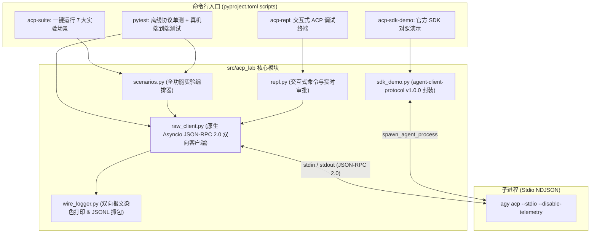
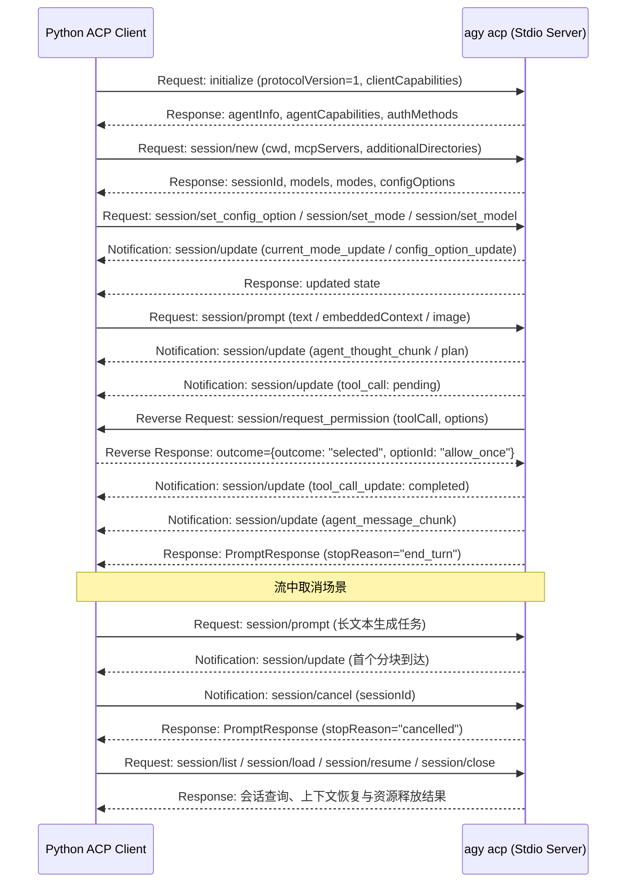

# ACP (Agent Client Protocol) 实验工程详细设计方案

## 1. 目标与背景 (Goal Description)

在 `/home/mickey/git/AI-it-is-depends-on-you/16_acp_simpale` 目录下，使用 **Python 3.12** 与 **`uv`** 构建一套完整的 **ACP（Agent Client Protocol，JSON-RPC 2.0 over stdio）** 实验与测试工程。该工程自动拉起本机 `agy acp`（实测版本：`Antigravity ACP Server v1.5.10`，`protocolVersion: 1`），通过客户端双向驱动并验证 ACP 的各项核心与扩展能力。

本实验工程同时提供两条对照路径与两种使用形态：
1. **原生异步 JSON-RPC 2.0 客户端 + 双向报文抓包器**：零黑盒展示客户端与 `agy acp` 之间收发的每一帧请求（Request）、响应（Response）、流式通知（Notification）与服务端反向回调（Server-to-Client RPC），并落盘 `.jsonl` 抓包文件便于对照协议规范分析。
2. **官方 `agent-client-protocol` (v1.0.0) Python SDK 对照示例**：演示如何通过官方 SDK 的 `spawn_agent_process` 与 `Client` 基类接入 `agy acp`。
3. **一键全功能实验套件（CLI 报告 + `pytest`）与交互式 REPL 调试器**：既能自动跑完所有 ACP 特性测试并输出结构化实验报告，也能进入交互式命令行手动体验会话切换、权限审批、流式取消与实时抓包观察。

---

## 2. 核心实验策略 (Design Policies)

- **模型配额与速度优化策略**：端到端测试真实连接 `agy acp` 发起对话。为避免消耗高昂模型配额并缩短测试耗时，客户端在创建会话后自动通过 `session/set_model` / `session/set_config_option` 优先切换至轻量快速模型（优先匹配 `gemini-3.8-flash-low` 或 `gemini-3.8-flash` + `thought_level=low`，若不可用则自动回退至会话默认模型）。
- **临时沙箱目录隔离**：所有工具调用与文件读写场景均在 `tempfile.TemporaryDirectory` 创建的隔离沙箱目录中运行（将其作为 `session/new` 的 `cwd`），并在测试结束后自动调用 `session/close` 清理会话，不会污染当前代码仓库。
- **保留真实权限问询链路**：拉起 `agy acp` 子进程时默认使用 `agy acp --stdio --disable-telemetry`（不开启 `--dangerously-skip-permissions`），从而在客户端真实拦截并验证 `session/request_permission` 的“放行（`allow_once`）”与“拒绝（`reject_once`）”双向交互流程。

---

## 3. 架构与协议交互设计

### 3.1 模块分层架构



### 3.2 双向 JSON-RPC 2.0 交互时序



---

## 4. 目录结构与模块职责

```text
16_acp_simpale/
├── .python-version                  # 锁定 Python 3.12
├── .gitignore                       # 忽略 .venv、缓存与运行期抓包日志 logs/
├── pyproject.toml                   # uv 依赖管理与 CLI 脚本声明
├── README.md                        # 快速上手、架构说明与协议报文解读手册
├── docs/
│   ├── 01_thinking_and_protocol_research.md  # 调研脉络、协议探测与思考过程
│   └── 02_implementation_plan.md             # 详细工程设计方案（本文档）
├── src/
│   └── acp_lab/
│       ├── __init__.py              # 公共符号导出
│       ├── wire_logger.py           # JSON-RPC 2.0 双向抓包记录器（终端分级回显 + JSONL 落盘）
│       ├── raw_client.py            # 原生 asyncio JSON-RPC 2.0 客户端与反向回调引擎
│       ├── scenarios.py             # 7 大 ACP 功能实验场景与报告生成器
│       ├── sdk_demo.py              # 官方 agent-client-protocol SDK 对照实现
│       └── repl.py                  # 交互式 ACP 调试终端
└── tests/
    ├── test_unit_protocol.py        # 基于内置 Mock ACP 子进程的离线协议层单元测试
    └── test_e2e_agy_acp.py          # 连接真实 agy acp 的全功能端到端测试套件
```

---

## 5. 七大实验测试场景矩阵

| 编号 | 实验场景 | 覆盖的 ACP 方法与特性 | 验证断言点 |
| :--- | :--- | :--- | :--- |
| **S1** | 握手与能力发现 | `initialize` | 校验 `protocolVersion == 1`、`agentInfo.name`、会话能力集与 `authMethods` |
| **S2** | 会话全生命周期与附加目录 | `session/new` (`additionalDirectories`), `session/list`, `session/close` | 新建会话出现在 `session/list` 中，校验返回的 `models`/`modes`/`configOptions`，关闭后正常释放 |
| **S3** | 模式、模型与思考等级动态配置 | `session/set_mode`, `session/set_model`, `session/set_config_option` | 切换至 Flash 模型与 `thought_level=low`；切换 `plan` -> `default` 模式并校验状态更新 |
| **S4** | 多类型 Prompt 与流式消息分块 | `session/prompt` (`text`, `resource`/`embeddedContext`, `image`), `session/update` | ① 纯文本问答流式拼接 `agent_message_chunk`；② 传入内嵌 `resource` 文本块提取密语；③ 纯标准库动态编码 32x32 纯红 PNG 图片块，验证多模态图像颜色识别 |
| **S5** | 会话持久化恢复与上下文记忆 | `session/prompt` -> 重新 `session/resume` / `session/load` | 首轮写入唯一随机口令，通过新进程或 `session/resume` / `session/load` 恢复同一 `sessionId`，验证 Agent 准确回忆出该口令 |
| **S6** | 工具追踪、权限自适应与双向反向 RPC | `tool_call` / `tool_call_update`, `session/request_permission`, `elicitation/create` (`accept` vs `decline`) | ① 验证沙箱文件写入与工具状态通知流（若宿主机未开全局 `always-proceed` 则额外断言 `allow_once` 与 `reject_once` 拦截）；② 100% 触发服务端反向请求 `elicitation/create`，分别验证客户端返回 `accept`（选中指定项）与 `decline`（取消提问）的双向闭环 |
| **S7** | 流式输出中途取消 | `session/prompt` + 异步触发 `session/cancel` | 发起长列表输出请求，收到流式更新分块后立即发送 `session/cancel` 通知，断言本轮提前取消返回且后续同一会话仍可正常响应新请求 |

---

## 6. 验证标准

1. `uv sync` 成功创建 Python 3.12 环境并解析安装全部依赖；
2. `uv run pytest tests/test_unit_protocol.py -v` 离线双向协议层单测全部通过；
3. `uv run pytest tests/test_e2e_agy_acp.py -v` 真实 `agy acp` 端到端测试全部通过；
4. `uv run acp-suite` 完整输出 7 大场景通过表格并生成 `logs/*.jsonl` 协议抓包日志；
5. `uv run acp-sdk-demo` 成功演示官方 `agent-client-protocol` SDK 连接 `agy acp` 完成对话与权限回调。
