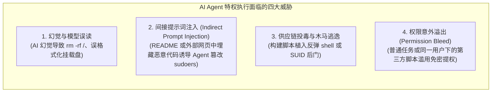
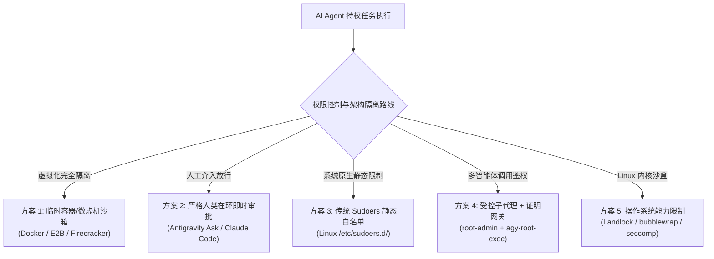
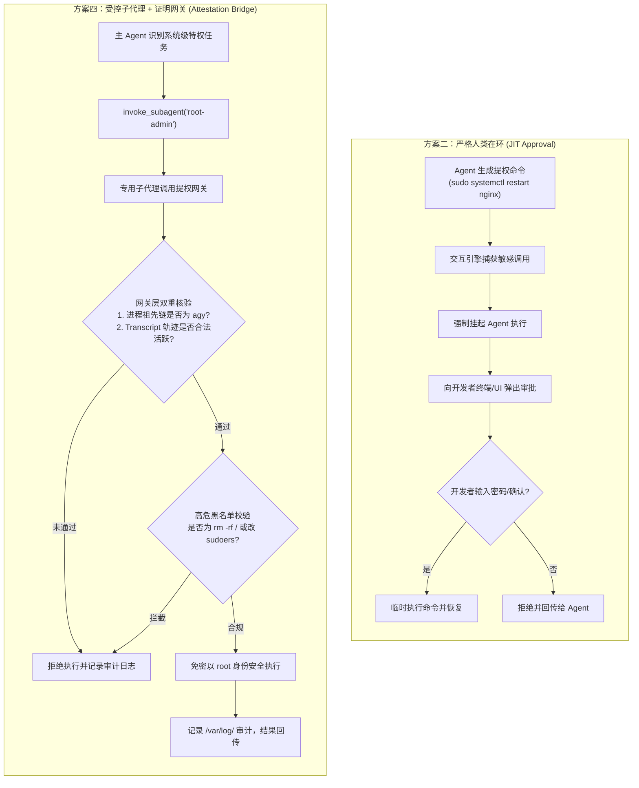

# AI Agent Root 特权管理方案全景调研与横向对比报告

---

## 目录
1. [执行摘要与核心结论](#1-执行摘要与核心结论)
2. [行业背景：AI Agent 的特权困境（The Root Dilemma）](#2-行业背景ai-agent-的特权困境the-root-dilemma)
3. [工业界 5 大主流特权管理方案全景解构](#3-工业界-5-大主流特权管理方案全景解构)
   - 3.1 [方案一：临时容器与轻量微虚机沙箱（Container / MicroVM Sandbox）](#31-方案一临时容器与轻量微虚机沙箱container--microvm-sandbox)
   - 3.2 [方案二：严格人类在环即时审批（Strict JIT Human-in-the-Loop）](#32-方案二严格人类在环即时审批strict-jit-human-in-the-loop)
   - 3.3 [方案三：传统 Sudoers 静态命令白名单（Static Sudoers Whitelisting）](#33-方案三传统-sudoers-静态命令白名单static-sudoers-whitelisting)
   - 3.4 [方案四：受控特权子代理与调用方鉴权网关（Controlled Subagent with Attestation Bridge）](#34-方案四受控特权子代理与调用方鉴权网关controlled-subagent-with-attestation-bridge)
   - 3.5 [方案五：操作系统内核级能力沙箱（OS Kernel Sandboxing: Landlock / bwrap）](#35-方案五操作系统内核级能力沙箱os-kernel-sandboxing-landlock--bwrap)
4. [五大方案全维度横向对比矩阵](#4-五大方案全维度横向对比矩阵)
5. [专项深度对比：受控子代理（方案四）vs 严格人类在环（方案二）](#5-专项深度对比受控子代理方案四-vs-严格人类在环方案二)
6. [主流方案定论与工业界演进趋势](#6-主流方案定论与工业界演进趋势)
7. [技术选型推荐框架（Decision Framework）](#7-技术选型推荐框架decision-framework)

---

## 1. 执行摘要与核心结论

随着自主型 AI Agent（如 Google Antigravity、Claude Code、Devin、OpenHands 等）从纯代码补全逐步演进为具备全栈工程运维能力的“端到端智能体”，**是否授予 Root 特权、以及如何管控 Root 特权**已成为系统架构设计的核心安全焦点。

### 核心结论速览：
1. **主流方案的场景分野（一分为二）**：
   - **云端多租户 / 自动化代码评测场景**：**“临时容器 / 微虚机沙箱（Ephemeral Container/MicroVM）”是绝对公认的工业界主流标准**（如 SWE-bench 评测基线、E2B、GitHub Codespaces、Devin）。在沙箱内部全量给予 `root` 或免密 `sudo`，依靠外部虚拟化强边界保障宿主机绝对安全，任务结束直接全量销毁。
   - **本地开发者工作站 / 真实宿主机场景**：**“严格人类在环（JIT 交互审批）”是当前商业级 CLI/IDE 产品的默认基线**（如 Antigravity 的 `Ask` 权限策略、Claude Code、Cursor）。默认以普通用户身份运行，任何提权命令必须向开发者弹窗展示完整命令与风险，由人类授权。
2. **长程自主性（Autonomy）与安全性的前沿突破**：
   - JIT 审批方案虽然安全，但会**彻底破坏 Agent 的长程无人值守执行能力**（如 `/goal` 或夜间批量任务）。
   - 为兼顾“宿主机真实环境运维”与“无人值守长程自动化”，前沿工程探索逐渐收敛至 **“受控特权子代理（Privileged Subagent）+ 进程/轨迹双重证明网关（Attestation Bridge）”**。通过将主 Agent 与特权 Agent 物理隔离，并在网关处实施防冒名校验与高危命令黑名单，实现了受控的免密提权。

---

## 2. 行业背景：AI Agent 的特权困境（The Root Dilemma）

### 2.1 为什么 Agent 需要 Root 特权？
在现代复杂的软件生命周期中，仅具备普通用户读写权限的 Agent 经常遭遇“执行阻断”：
- **系统级底层依赖安装**：如 `apt-get install`、`dnf`、编译底层 C/C++ 库所需的内核头文件。
- **容器与虚拟化引擎管理**：启动/配置 Docker Daemon、Podman 外部挂载存储（如 JuiceFS/NFS）、管理网络命名空间（`iptables`/`ip netns`）。
- **系统守护进程运维**：使用 `systemctl start/restart/status` 调试本地 Redis/PostgreSQL、查看 `/var/log` 核心系统日志。
- **性能剖析与底层观测**：使用 `perf`、`ebpf`、`strace` 追踪生产级故障。

### 2.2 核心安全威胁模型（Threat Model）
如果直接给 Agent 开启传统的无条件免密 `sudo`，将面临四大致命安全风险：



---

## 3. 工业界 5 大主流特权管理方案全景解构



---

### 3.1 方案一：临时容器与轻量微虚机沙箱（Container / MicroVM Sandbox）
#### 核心架构
- Agent 并不运行在开发者或企业的真实宿主机上，而是运行在一个专门为该会话动态启动的轻量隔离容器（Docker/Podman）或微型虚拟机（Firecracker/gVisor）中。
- 在容器内部，Agent 直接以 `root` 运行，或者拥有完全无限制的 `NOPASSWD: ALL` 权限。
- 任务执行完毕后，整个容器/微虚机直接被 `docker rm -f` 物理销毁。

#### 工业界代表
- **SWE-bench**：业界最权威的软件工程 Agent 测评基准，官方强制要求每个基准用例必须在完全独立的 Docker 容器中跑评测。
- **E2B (Code Interpreter)**：为 AI Agent 打造的云端执行沙箱，基于微虚拟机秒级冷启动，提供完全的 root 隔离环境。
- **OpenHands (原 OpenDevin)**：默认将 Agent 的终端执行全部代理至专门的 Docker 容器中执行。
- **Cognition Devin / GitHub Codespaces**：云端托管的端到端隔离开发沙箱。

#### 优缺点评估
- **✅ 优点**：
  - **安全性绝对封顶**：哪怕 Agent 执行了 `rm -rf /` 或格式化磁盘，受损的也只是临时沙箱，宿主机坚若磐石。
  - **Agent 自由度极高**：AI 无需任何顾虑，可任意升级系统内核参数、安装任意依赖、随意修改系统服务。
- **❌ 缺点**：
  - **宿主机管控能力为零**：无法直接管理宿主机本身的硬件驱动、本地外接设备、物理网络接口或本地守护服务。
  - **I/O 与冷启动开销**：容器拉起、代码全量克隆与依赖下载存在明显延迟与存储占用。

---

### 3.2 方案二：严格人类在环即时审批（Strict JIT Human-in-the-Loop）
#### 核心架构
- Agent 进程完全以普通用户（如 `uid=1000`）运行在宿主机上，系统底层绝不配置任何免密 `sudo`。
- Agent 在生成带有 `sudo` 的特权命令时，系统交互引擎拦截该操作，在终端或 Web UI 弹出**即时确认对话框（Just-In-Time Prompt）**。
- 对话框清晰显示：**要执行的完整命令字符串、调用原因、潜在破坏性预警**。必须由人类明确输入密码或按下确认键后，命令才被临时放行执行。

#### 工业界代表
- **Google Antigravity 统一权限引擎（`Ask` 策略）**：对于敏感命令和写操作，触发统一权限确认机制；在 CLI 中可通过状态提示或 `Alt + J` 审批。
- **Claude Code (Anthropic)**：终端 Agent 运行时的基线策略，遇到非只读的系统级修改必须由用户在终端按下回车批准。
- **Cursor Terminal / Windsurf**：在终端自动执行带有潜在风险的命令前，提示开发者确认。

#### 优缺点评估
- **✅ 优点**：
  - **零特权外溢风险**：系统底层保持绝对纯净，不存在任何可被攻击者利用的免密提权后门。
  - **直观可控**：每一次提权都有人类专业双眼的审查把关，符合传统研发团队的心理安全预期。
- **❌ 缺点**：
  - **长程自主性（Autonomy）归零**：Agent 无法进行夜间跑批、长程自动化重构（如 `/goal`）；一旦遇到 `sudo` 就会停滞等待人类介入。
  - **审查疲劳（Alert Fatigue）**：频繁的弹窗审批容易导致开发者不假思索地一路点击“同意”，反而失去审查意义。

---

### 3.3 方案三：传统 Sudoers 静态命令白名单（Static Sudoers Whitelisting）
#### 核心架构
- 在 Linux 系统原生的 `/etc/sudoers.d/agent-rules` 中配置静态白名单，仅允许当前普通用户免密运行某些特定命令：
  ```sudoers
  mickey ALL=(root) NOPASSWD: /usr/bin/apt-get update, /bin/systemctl status *
  ```

#### 工业界代表
- 传统企业内部的 Ansible 运维编排、自动化发布部署脚本、Jenkins Agent 节点。

#### 优缺点评估
- **✅ 优点**：
  - 原生支持：直接利用 Linux 操作系统成熟的 Sudoers 机制，无需编写额外软件或网关。
  - 确定性强：严格限定了可执行的二进制文件路径。
- **❌ 缺点**：
  - **GTFOBins 逃逸漏洞频发**：在 Linux 中，大量看似无害的命令（如 `vim`、`less`、`find`、`awk`、`tar`、`env`、`python3`）一旦进入免密白名单，Agent（或恶意注入代码）都可以通过其内置参数轻松派生交互式 Root Shell，导致白名单形同虚设。
  - **维护成本高且僵化**：Agent 解决真实问题所需的命令千变万化，静态白名单会导致 Agent 频繁因权限不足而崩溃。

---

### 3.4 方案四：受控特权子代理与调用方鉴权网关（Controlled Subagent with Attestation Bridge）
#### 核心架构
- **权限与身份物理分离**：主 Agent（日常对话与通用编码）完全运行在普通用户权限下，禁止提权。
- **专用特权 Subagent**：仅在明确需要 Root 的运维任务时，主 Agent 通过 `invoke_subagent` 委派专属子代理（如 `root-admin`）。
- **底层双重调用方鉴权（Caller Attestation Bridge）**：
  通过专门受控的 Sudoers 提权网关（如 `/usr/local/sbin/agy-root-exec`）进行硬核鉴权：
  1. **Linux 进程树回溯（Process Lineage）**：校验调用进程的父级祖先链是否合法（必须来自指定的 Agent 二进制）。
  2. **会话轨迹密码学/状态证明（Transcript Attestation）**：校验传入的子会话 ID 是否确系由父会话派生出的活跃合法特权子代理，且生命周期尚未结束。
  3. **高危命令黑名单硬拦截**：在网关内部阻断 `rm -rf /`、修改 `sudoers`、篡改 shadow 密码文件等行为。

#### 工业界代表
- 现代前沿**凭据代理模式（Credential Broker Pattern）**与多智能体分级权限架构；针对宿主机开发环境下的前沿自研特权调度体系。

#### 优缺点评估
- **✅ 优点**：
  - **兼顾无人值守与宿主机控制**：在不需要人类反复弹窗确认的前提下，允许 Agent 安全协助处理宿主机服务与系统维护。
  - **防范权限泄漏与冒名滥用**：主 Agent、普通子 Agent 以及宿主机上的其他第三方脚本，即使调用该桥接器也会因无合法 Agent 轨迹而被 100% 拒绝。
- **❌ 缺点**：
  - **架构实现复杂度高**：需要深度适配 Agent 运行时的日志规范与进程追踪机制。
  - **黑名单非万全之策**：需要精心设计高危命令防篡改策略，防止高阶代码混淆逃逸。

---

### 3.5 方案五：操作系统内核级能力沙箱（OS Kernel Sandboxing: Landlock / bwrap）
#### 核心架构
- 不依赖全量虚拟化，而是直接利用 Linux 内核的原生安全子系统（**Landlock LSM**、**bubblewrap (bwrap)**、**cgroups v2**、**seccomp**）。
- Agent 哪怕在普通用户或通过提权执行命令时，其派生的子进程都会被包裹在内核沙箱内：限制其能够读取/写入的目录白名单（如只允许写入当前工作区，禁止读取 `~/.ssh` 或修改 `/etc`），并剥离不必要的系统调用能力（Capabilities）。

#### 工业界代表
- **Google Antigravity Terminal Sandbox**：内置针对终端命令的文件系统与网络隔离。
- **Flatpak / Snap 桌面应用隔离**、**Chromium 浏览器沙箱**。

#### 优缺点评估
- **✅ 优点**：
  - **原生极速（零启动开销）**：完全由 Linux 内核直接限制，没有容器或虚机的内存与 I/O 损耗。
  - **细粒度文件路径防护**：哪怕以 root 运行，内核级别的 Landlock 也能拒绝其向工作区外的关键敏感路径写入文件。
- **❌ 缺点**：
  - **功能受限**：如果 Agent 的任务恰好需要修改系统网络或安装全局软件，过于严苛的沙箱会导致命令失败。
  - **跨平台一致性差**：深度依赖 Linux 内核版本（Landlock 需要 Linux 5.13+），在 macOS 或 Windows 上无法直接通用。

---

## 4. 五大方案全维度横向对比矩阵

| 对比维度 | 方案一：临时容器/微虚机沙箱 | 方案二：严格人类在环即时审批 | 方案三：静态 Sudoers 白名单 | 方案四：受控子代理+证明网关 | 方案五：OS 内核级能力沙箱 |
| :--- | :--- | :--- | :--- | :--- | :--- |
| **宿主机安全性** | 🟢 **极高（物理级隔离）** | 🟢 **极高（人工双眼把关）** | 🔴 **低（易被 GTFOBins 逃逸）** | 🟡 **高（进程链+会话轨迹绑定）** | 🟢 **很高（Linux 内核硬约束）** |
| **长程无人值守能力** | 🟢 **完美支持（无弹窗）** | 🔴 **不支持（频繁阻塞打断）** | 🟢 **支持（免密自动）** | 🟢 **支持（受控自主提权）** | 🟢 **支持（内核级放行）** |
| **宿主机环境操控力** | 🔴 **无（仅影响容器内）** | 🟢 **完全直接操控** | 🟡 **仅能操控特定程序** | 🟢 **完全直接操控（防毁盘）** | 🟡 **受限于挂载白名单** |
| **部署与运维复杂度** | 🟡 **中（需 Docker/微虚机）** | 🟢 **极低（开箱即用）** | 🟢 **低（配配置即可）** | 🔴 **较高（需编写网关验证逻辑）** | 🟡 **中（需内核版本支持）** |
| **冷启动与性能开销** | 🔴 **较重（几秒到几十秒）** | 🟢 **零性能开销** | 🟢 **零性能开销** | 🟢 **毫秒级开销** | 🟢 **纳秒级（内核原生）** |
| **防 Prompt 注入能力** | 🟢 **高（毁坏容器无所谓）** | 🟢 **高（人类能识别恶意意图）** | 🔴 **极弱（易被注入利用）** | 🟡 **较高（黑名单+审计日记）** | 🟢 **高（限制写入范围）** |
| **工业界普及度** | 🌟 **云端评测绝对主流** | 🌟 **本地 CLI 商业基线** | ⚪ **传统运维，AI 渐被弃用** | 🚀 **前沿高级自研方案** | 🛡️ **底层辅助沙箱标配** |

---

## 5. 专项深度对比：受控子代理（方案四）vs 严格人类在环（方案二）

针对用户明确提出重点调研的两大路线（宿主机真实环境下的两大核心选型），我们展开深度的攻防与工程对比：



### 深度博弈分析：

| 维度 | 方案二：严格人类在环（JIT） | 方案四：受控子代理 + 证明网关 |
| :--- | :--- | :--- |
| **本质安全机制** | **“生物信任（Human Trust）”**：信任人类判断，系统本身不增加复杂规则。 | **“加密状态与程序学证明（Attestation Trust）”**：信任由执行链路和状态机证明的上下文。 |
| **长程自动化表现** | **较差**。当运行 `/goal` 执行复杂跨环境部署时，往往在执行 30 分钟后因为一条微不足道的 `sudo` 挂起，直到第二天早晨开发者回到电脑前才被唤醒。 | **极佳**。整个长程任务可以一口气跑完，宿主机系统依赖与底层状态流转无需人类在线值守。 |
| **突发灾难防护能力** | **完全依赖人类警惕性**。若模型因为幻觉产生包含不可逆破坏的代码（如误操作清理生产数据），在深夜疲劳的开发者极易盲目点击“放行”。 | **基于确定性代码逻辑防护**。网关代码以硬逻辑直接拒绝 `rm -rf /`、直接拒绝写穿 `/dev/sd*`，不会受人的疲劳心理影响。 |
| **权限隔离范围** | **零隔离**。主 Agent 和子 Agent 都运行在同一上下文，任何对话都可以尝试发起 `sudo` 弹窗。 | **严格隔离**。日常主 Agent（如 `general`）完全不享有提权通道，即便被 Prompt 注入也无法通过网关鉴权；特权被死死锁定在专用子会话中。 |
| **维护与合规审计** | 日常终端审计分散，无独立特权执行专用日志。 | 网关强制生成只有 `root` 权限可读的专用审计日志文件（如 `/var/log/agy-root-agent.log`），企业合规性更高。 |

---

## 6. 主流方案定论与工业界演进趋势

### 6.1 工业界主流定论（行业公认共识）
根据目前 GitHub、各大顶级 AI 实验室（Google DeepMind、Anthropic、OpenAI）以及前沿开源 Agent 社区的实践，行业形成了极其清晰的**两分天下（Two Mainstreams）**：

1. **场景 A：云端托管与自动化代码评测（Cloud & Eval）**
   - 🌟 **绝对主流：方案一（临时容器 / 微虚机沙箱）**
   - **背后的商业逻辑**：在云端多租户或评测自动化中，机器不是开发者的个人电脑，而是临时基础设施。在 Docker / Firecracker 内部给 root 是最低成本、最具通用性的方案，既不用担心破坏物理环境，又能赋予 Agent 100% 的解决问题能力。
2. **场景 B：本地开发环境与桌面端 Agent（Local Developer Workstations）**
   - 🌟 **绝对主流：方案二（严格人类在环 JIT 审批）**
   - **背后的产品逻辑**：个人电脑拥有私钥、工作资料和持久化操作系统。任何商业级产品（Google Antigravity、Claude Code、Cursor）在默认策略下**绝不敢为用户开启免密提权**。让开发者成为每一次提权的最终责任人，是法律合规与安全的唯一稳妥基线。

---

### 6.2 下一代工业界演进趋势：混合防御架构（Hybrid Escalation Model）

随着开发者对“端到端全自动交付（无人值守长程运行）”的需求愈发迫切，行业正在从单一的 JIT 审批，向 **“受控分级 + 动态降级回退”的混合架构** 演进：

```mermaid
flowchart TD
    Cmd["Agent 生成特权操作请求"] --> Filter{"受控网关风险评估与鉴权"}

    Filter -->|1. 鉴权失败或外部脚本| Block["直接拦截 (Deny)"]
    Filter -->|2. 命中高危黑名单 (毁盘/改密码)| Block
    Filter -->|3. 低/中风险已知日常运维 (systemctl/包安装)| Auto["专用子代理免密受控执行<br/>(方案四: 保证无人值守流畅度)"]
    Filter -->|4. 高风险未决操作 / 异常复杂命令| Fallback["动态降级为 JIT 人工确认<br/>(方案二: 唤醒人类终审)"]
```

- **分流机制**：
  - 日常、重复、标准化的系统维护（如重启测试服务、安装声明在 requirements 中的库）：由**专用受控子代理（方案四）**自动消化，不打扰人类。
  - 真正高风险、不可逆或具有歧义的破坏性操作：自动降级触发 **JIT 人工在环审批（方案二）**。
  - 这种混合架构被公认为是解决“自主性”与“安全性”鱼与熊掌不可兼得的最优演进方向。

---

## 7. 技术选型推荐框架（Decision Framework）

根据不同的工程目标与运行宿主，推荐采用以下决策树进行选型：

```text
您的 Agent 运行在什么环境？
│
├── 运行在云端服务器 / CI/CD 流水线 / SWE-bench 评测体系？
│   └── 🎯 坚决选用【方案一：临时容器/微虚机沙箱 (Docker / E2B)】
│       (容器内直接全量 root，容器外强隔离，一次性销毁，最省心、最标准)
│
└── 运行在开发者日常个人电脑 / 本地物理机工作站？
    │
    ├── 核心诉求是纯日常辅助编码，每次操作都有人在电脑前盯守？
    │   └── 🎯 选用【方案二：严格人类在环即时审批 (JIT Approval)】
    │       (零侵入、零特权外溢、 Antigravity 官方 Ask 默认策略，最稳妥)
    │
    └── 核心诉求是长程无人值守 (/goal)，且 Agent 需要协助维护本地宿主机系统服务？
        └── 🎯 选用【方案四：受控特权子代理 + 双重证明网关】
            (主 Agent 保持普通权限防日常误用，仅在派发专用子代理且通过进程/会话双重核验后，
             在安全黑名单约束下免密执行系统运维)
```
