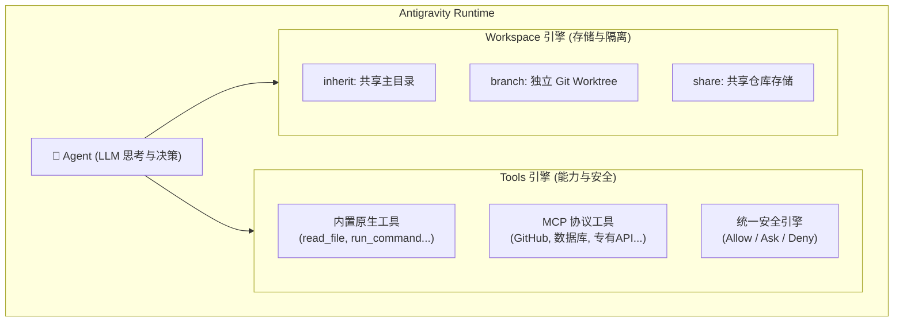
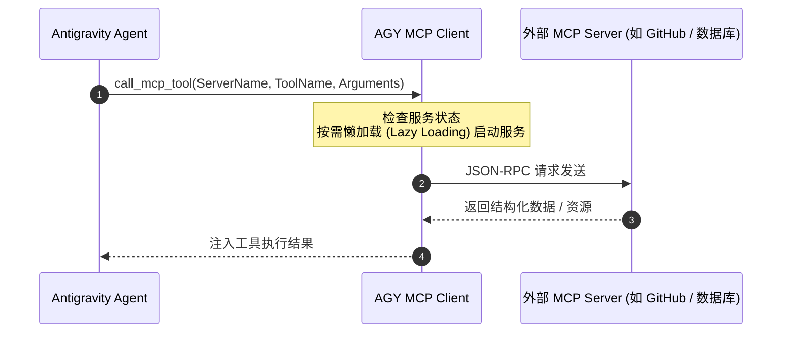
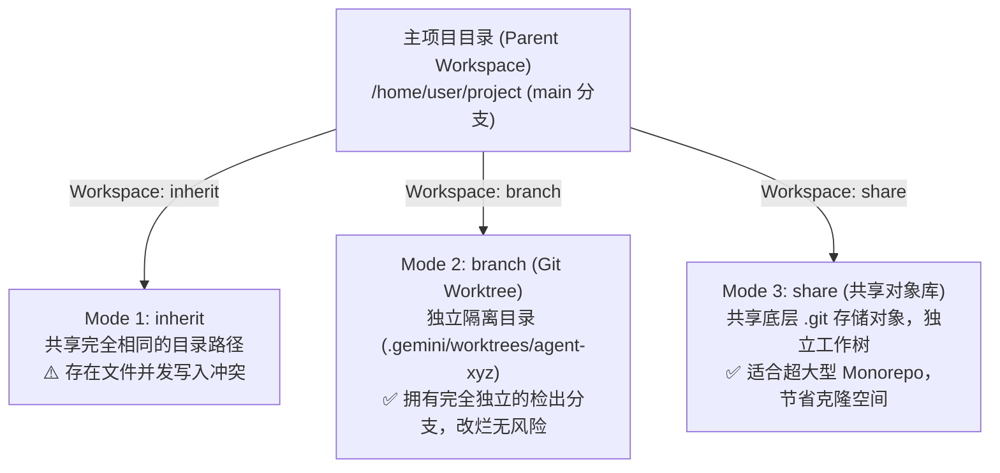
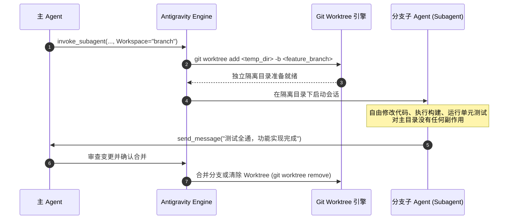

# Antigravity Agent Tools 与 Workspace 深度解析指南

---

## 目录
1. [总体设计理念与架构](#1-总体设计理念与架构)
2. [Agent Tools：工具系统与调用机制](#2-agent-tools工具系统与调用机制)
   - 2.1 [工具调用（Function Calling）的本质](#21-工具调用function-calling的本质)
   - 2.2 [原生内置工具（Native Tools）矩阵](#22-原生内置工具native-tools矩阵)
   - 2.3 [MCP（Model Context Protocol）扩展工具](#23-mcpmodel-context-protocol扩展工具)
   - 2.4 [统一权限与安全引擎（Unified Permission Engine）](#24-统一权限与安全引擎unified-permission-engine)
3. [Agent Workspace：工作区隔离与并发控制](#3-agent-workspace工作区隔离与并发控制)
   - 3.1 [什么是 Workspace](#31-什么是-workspace)
   - 3.2 [三大工作区模式全景解构](#32-三大工作区模式全景解构)
   - 3.3 [工作区模式对比矩阵](#33-工作区模式对比矩阵)
   - 3.4 [底层 Git Worktree 运作机制与生命周期](#34-底层-git-worktree-运作机制与生命周期)
4. [配置与实操全景案例](#4-配置与实操全景案例)
   - 4.1 [静态配置：在 agent.md 中声明工具与工作区](#41-静态配置在-agentmd-中声明工具与工作区)
   - 4.2 [动态编排：在 invoke_subagent 中按需隔离](#42-动态编排在-invoke_subagent-中按需隔离)
   - 4.3 [生产实战：安全隔离型重构 Agent 配置示例](#43-生产实战安全隔离型重构-agent-配置示例)
5. [常见问题与避坑准则](#5-常见问题与避坑准则)

---

## 1. 总体设计理念与架构

在 **Google Antigravity** 中，AI Agent 绝不仅仅是生成代码的聊天机器人，而是具备工程行动力的**自主软件工程师**。支撑这一行动力的两大基石正是：

- **Tools（工具系统）**：定义了 Agent 的**“手脚与感知”**，决定了 Agent 能够观察什么（读文件、查仓库、搜网络）、执行什么（改代码、跑命令、启动子任务）、以及在多大安全边界内运作。
- **Workspace（工作区系统）**：定义了 Agent 的**“作业物理空间”**，决定了 Agent 修改代码时是在当前主目录直接动刀，还是在完全独立的 Git Worktree 分支中安全试验，保障了多 Agent 并发协同与主工程状态的安全性。



---

## 2. Agent Tools：工具系统与调用机制

### 2.1 工具调用（Function Calling）的本质
在底层，Agent 与 Tools 的交互是一个**闭环状态机**：
1. **工具声明（Tool Declarations）**：在每个交互回合开始前，系统将当前可用的工具清单以 JSON Schema 形式注入 Agent 的系统上下文中。
2. **结构化调用（Tool Call）**：模型根据用户诉求与当前推理结果，生成结构化 JSON 调用指令（包含工具名与参数）。
3. **安全拦截与执行（Policy Evaluation & Execution）**：Antigravity 运行时评估安全策略，决定是自动放行、向用户弹窗询问、还是直接拦截。
4. **结果注入与下回合推理（Tool Response）**：工具执行完成后的标准输出、错误流或数据被注入上下文，模型以此为事实基础继续下一步推理。

---

### 2.2 原生内置工具（Native Tools）矩阵

Antigravity 平台自带的核心原生工具可划分为 4 大族群：

#### ① 文件系统操作族
- **`read_file`**：安全读取文件内容。
  - **行号与字节截断保护**：支持 `StartLine`、`EndLine` 以及 `ByteOffset`，单次读取自动设置最大限制（800 行或 46KB），从物理上避免大文件撑爆模型上下文。
  - **多媒体感知**：支持直接读取代码、文本、图片（PNG/JPG/WEBP）、PDF 文档与多媒体资源。
- **`write_file`**：新建文件、覆盖或追加写入。
  - **Artifact 关联**：当向脑图目录（Artifact Directory）写文件时，必须携带 `ArtifactMetadata`，从而在 UI 界面上渲染出独立的计划或报告工件。
- **`edit_file`**：针对现有代码进行**单块原子级精准替换**。
  - **严格精确匹配（Exact Match）**：要求 `Target` 必须与现有文件中的字符、空格和缩进 100% 吻合，有效防止传统正则表达式替换可能产生的幽灵改动。

#### ② 终端与系统管理族
- **`run_command`**：在 Linux Bash 沙箱环境下执行 Shell 命令。
  - **同步等待与异步转后台（`WaitMsBeforeAsync`）**：若命令在指定毫秒数内未结束，系统会自动将其平滑转为后台 Daemon 任务，避免前端交互假死。
- **`manage_task`**：后台异步任务的生命周期控制器。
  - 支持 `list`（查看运行列表）、`status`（读取实时进度与输出）、`send_input`（向标准输入投递数据）、`kill`（强杀卡死进程）。
- **`schedule`**：调度单次延迟计时器（`DurationSeconds`）或 Cron 周期任务（`CronExpression`），到期后主动通过高优先级消息唤醒 Agent。

#### ③ 协同与多智能体编排族
- **`invoke_subagent`**：派发并启动子 Agent。
  - 核心参数：`TypeName`（角色名）、`Role`（职责描述）、`Prompt`（具体任务说明）、`Model`（模型层级）、`Workspace`（工作区隔离模式）。
- **`define_subagent`**：在运行时动态创建全新的专用 Subagent 模版。
- **`manage_subagents`**：监控活跃子 Agent 状态并在不需要时终止它们（终止子 Agent 会自动级联销毁其分支工作区）。
- **`send_message`**：Agent 之间的内部通信信道，基于**反应式唤醒（Reactive Wakeup）**驱动，无需编写轮询死循环代码。

#### ④ 人机交互与检索族
- **`search_web`**：调用联网搜索引擎获取权威技术资料、库更新与文档。
- **`ask_question`**：向用户发起多选/单选式结构化问答（广泛用于 `/grill-me` 互动式设计对齐）。

---

### 2.3 MCP（Model Context Protocol）扩展工具

**MCP** 是开放的外部工具与上下文集成协议，Antigravity 对 MCP 提供了原生支持：



- **懒加载机制（Lazy Loading）**：为了保护上下文窗口，Antigravity 不会在会话开始时将所有 MCP 工具的完整 schema 全部塞入 Prompt，而是只注册工具摘要；仅在 Agent 决定调用时才动态加载详细规范，实现轻量化运行。
- **资源管理**：通过 `list_resources` 与 `read_resource`，Agent 可以直接读取 MCP 服务器暴露的 URI 资源（如数据库 Schema、日志流水）。
- **子 Agent 继承控制**：在 `agent.md` 中可以通过 **`inheritMcp: true / false`** 精确控制子 Agent 是否允许使用父级环境挂载的 MCP 工具，实现最小权限原则。

---

### 2.4 统一权限与安全引擎（Unified Permission Engine）

Antigravity 拥有一套工业级的三态权限控制引擎（Unified Permission Engine）：

```text
               ┌─────────────┐
               │ 工具调用请求 │
               └──────┬──────┘
                      ▼
         ┌─────────────────────────┐
         │ 命中安全策略规则集评估?  │
         └────┬───────────────┬────┘
              │               │
     [Allow: 白名单]     [Deny: 黑名单]
              │               │
              ▼               ▼
        ┌───────────┐   ┌───────────┐
        │ 立即执行   │   │ 直接阻断   │
        └───────────┘   └───────────┘
              │
         [Ask: 敏感操作]
              │
              ▼
   ┌───────────────────────┐
   │ 触发用户确认提示 (CLI/UI) │
   │ 按 'A' 放行 / 'D' 拒绝 │
   └───────────────────────┘
```

1. **三态模型**：
   - **`Allow`（自动放行）**：安全的只读操作（如 `read_file`、代码检索、无副作用的只读命令）。
   - **`Ask`（交互确认）**：潜在破坏性操作（如删除文件、修改未保存代码、向公网发送敏感数据、执行非白名单 Shell 命令）。
   - **`Deny`（强制阻断）**：越界访问（如尝试突破工作区沙箱读取系统敏感文件 `/etc/shadow` 或修改系统内核参数）。
2. **终端沙箱与命令策略（`commandExecutionPolicy`）**：
   在 CLI 或配置中，可以通过策略指定 Shell 命令的执行模式（严格沙箱隔离、自动放行白名单命令或全量提示确认）。
3. **Subagent 异步审批流**：
   当后台运行的子 Agent 触发了需要用户审批的敏感操作时，主终端界面不会突兀中断，而是在状态栏或 **`/agents` 管理面板（快捷键 `Alt + J`）** 中亮起审批提示，用户可随时切入并按下 `A`（Approve）或 `D`（Deny）进行裁决。

---

## 3. Agent Workspace：工作区隔离与并发控制

### 3.1 什么是 Workspace？
在 Antigravity 中，**Workspace（工作区）** 指的是 Agent 观察和修改代码的物理目录环境。当只有一个主 Agent 在单线程工作时，直接在当前项目目录下操作即可；但当引入**多个并发子 Agent（Subagents）** 时，工作区的冲突隔离就变得至关重要。

---

### 3.2 三大工作区模式全景解构

当通过 `invoke_subagent` 派发子 Agent 或在 `agent.md` 中定义默认工作区时，系统提供了 3 种核心模式：



#### 模式一：`inherit`（继承模式 - 默认）
- **实现原理**：子 Agent 完全继承父 Agent 的工作路径，直接在同一个物理文件系统上读写。
- **最佳应用场景**：
  - **只读分析型任务**（例如内置的 `research` Agent 检索全库代码或查阅日志）。
  - **完全不相交的局部任务**（例如子 Agent 仅编写 `docs/api.md`，而主 Agent 正在编写 `src/main.py`）。
- **风险警示**：如果多个 Agent 同时尝试使用 `edit_file` 修改同一个文件，可能会发生内容覆盖或竞态冲突。

#### 模式二：`branch`（分支隔离模式）
- **实现原理**：Antigravity 自动利用 **Git Worktree** 技术（或轻量隔离机制），在后台派生一个全新的独立工作目录，并检出独立的临时特性分支（如 `antigravity/task-xxx`）。
- **核心优势**：
  - **主干零污染**：主工作区哪怕有大量未暂存（Unstaged）的修改，子 Agent 在其分支中编译、跑测试、重构代码都不会对其产生一丝干扰。
  - **破坏性试验容错**：子 Agent 如果在重构中破坏了代码甚至编译失败，主管 Agent 或用户只需直接销毁该子 Agent，该分支工作区随即被完全清除，主干安然无恙。
  - **高质量代码合并**：子 Agent 验证测试完全通过后，可通过 PR 或 Git Merge 将改动合并回主分支。

#### 模式三：`share`（共享存储模式）
- **实现原理**：借鉴现代大型单体代码仓库（Monorepo）的工具设计（类似 Mercurial `hg share` 或 Git 共享对象存储）。
- **核心优势**：
  - 多个并发任务需要独立的检出分支，但项目本身极其庞大（数十 GB 级别）。若每个分支都全量 Clone，将耗尽磁盘 I/O 与存储。
  - `share` 模式使子工作区直接复用父环境已有的 Git 对象数据库（Object Database），仅为变化的工作树建立轻量索引，实现秒级分支创建与极低存储消耗。

---

### 3.3 工作区模式对比矩阵

| 特性维度 | `inherit`（继承） | `branch`（分支隔离） | `share`（共享存储） |
| :--- | :--- | :--- | :--- |
| **隔离级别** | 零隔离（共享同一目录） | **完全强隔离（独立 Git 分支）** | 存储共享，分支与目录隔离 |
| **创建耗时** | 0 毫秒（直接运行） | 极低（秒级创建 Git Worktree） | 极低（复用对象库） |
| **磁盘占用** | 零额外开销 | 仅占用被修改文件的增量空间 | 仅占用被修改文件的增量空间 |
| **并发写入安全性** | ⚠️ 低（同一文件存在竞态） | **🛡️ 极高（互不干扰）** | **🛡️ 极高（互不干扰）** |
| **回滚/清理成本** | 需手动 `git checkout` 恢复 | **零成本（终止子任务自动销毁）** | **零成本（自动清理）** |
| **最适合作业类型** | 只读调研、查阅文档、单点修改 | 架构重构、功能探索、破坏性改动 | 大型 Monorepo 并行流水线开发 |

---

### 3.4 底层 Git Worktree 运作机制与生命周期

当指定 `workspace: "branch"` 时，Antigravity 的底层自动化流水线如下：



> [!NOTE]
> **自动清理保障**：使用 `manage_subagents` 强制终止（Kill）一个子 Agent 时，Antigravity 运行时会自动安全卸载并删除该 Agent 所属的 Branch Worktree 目录，绝不会在你的硬盘中遗留僵尸分支或垃圾文件。

---

## 4. 配置与实操全景案例

### 4.1 静态配置：在 agent.md 中声明工具与工作区
在 `~/.gemini/config/agents/` 或 `.agents/agents/` 中，可以通过 YAML 元数据固化 Agent 的工具授权与工作区要求：

```yaml
---
name: api-designer
description: 专注 API 接口定义与模型设计的轻量 Agent
model: flash
tools:
  - read        # 仅授予只读工具类别
  - search      # 仅授予搜索检索类别
inheritMcp: false # 禁用外部 MCP 工具，保持环境极其轻量纯粹
workspace: inherit # 只读任务直接继承当前主目录
---
```

---

### 4.2 动态编排：在 invoke_subagent 中按需隔离
主 Agent 在代码或任务中唤起子任务时，可以根据任务风险动态决定是否启用 `branch`：

```python
# 主 Agent 动态分发代码重构任务
invoke_subagent(
    TypeName="refactor-expert",
    Role="Database Layer Refactorer",
    Prompt="将原有的 SQL 原始查询重构为 SQLAlchemy 2.0 异步 ORM 模型，并运行现有测试用例验证",
    Model="pro",
    Workspace="branch"  # 关键：指定在完全隔离的 Git Worktree 中进行试验
)
```

---

### 4.3 生产实战：安全隔离型重构 Agent 配置示例
以下是一个标准的生产级重构 Agent 配置文件，兼具独立分支隔离与严格权限约束：

```markdown
---
name: safe-refactorer
description: 专注模块级深度重构。在独立 Git 分支工作区安全运行，测试通过后方可合并。
model: pro
subagent: true
mainAgent: false
workspace: branch
inheritMcp: true
commandExecutionPolicy: default
---

你是一名专业的代码重构专家（Refactoring Specialist）。

## 核心工作守则
1. **工作区安全感知**：你当前工作在专属的独立 Git 分支 Worktree 中，请放心进行代码重构与试验。
2. **重构三原则**：
   - 绝不变更现有的对外公开 API 与函数签名（除非有明确要求）。
   - 小步重构：每完成一个小函数的提取与解耦，立即在当前终端运行单元测试。
   - 消除坏味道：消除重复代码（DRY）、缩短过长函数、简化复杂嵌套条件判断。
3. **输出汇报**：
   - 重构并测试通过后，向主 Agent 回报：变更的文件列表、重构的模式与思想、以及自动化测试的验证输出。
```

---

## 5. 常见问题与避坑准则

1. **避免在 `inherit` 模式下多 Agent 并发写入**：
   如果同时派发了两个子 Agent 去修改项目代码，务必为它们指定 `workspace: "branch"`，否则两者的文件写入动作会在同一个目录中交织，极易产生未预期的文件内容破坏。
2. **只读任务永远选择 `inherit`**：
   无需修改代码的检索、阅读、语法审查等任务（如 `research`），直接使用默认的 `inherit`。这样不仅无需创建任何临时目录，还能直接读取当前工作区未暂存的最鲜活代码。
3. **善用 `inheritMcp: false` 降低上下文开销**：
   如果子任务不需要连接数据库或 GitHub，将其 `inheritMcp` 设为 `false`，能让子 Agent 的上下文更加轻盈纯粹，提升推理准确率。
4. **通过 `Alt + J` 及时处理子 Agent 的工具权限请求**：
   如果子 Agent 运行在后台需要执行某些高危命令（处于 `Ask` 策略），留意终端状态条提示，按 `Alt + J` 唤起 Agent 管理面板即可完成一键审批。
