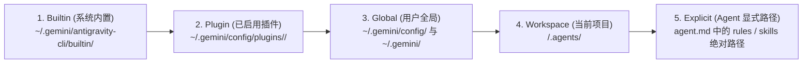

# Google Antigravity (AGY) Agent 配置底层机制与完整参考手册（AI & 开发者速查版）

> **文档定位**：本文档基于 Antigravity 内置技能规范与 `/usr/local/bin/agy` 二进制底层实现（`ParseAgentScriptItemFromMarkdown`、`getCustomAgentConfig`、`ResolveCustomAgentSpec`、`discoverExplicitPath`、`collectSkills` 等核心函数）逆向验证整理而成。旨在为 AI Agent 与开发者提供一份**零歧义、字段完备、可直接复制执行**的 Agent 配置权威参考手册。

---

## 目录

1. [系统架构与配置文件全景图](#1-系统架构与配置文件全景图)
2. [自定义 Agent 文件规范（`agent.md` 完整 Schema）](#2-自定义-agent-文件规范agentmd-完整-schema)
3. [核心机制深度解析（基于二进制实现验证）](#3-核心机制深度解析基于二进制实现验证)
   - 3.1 [主/子 Agent 身份控制（`mainAgent` vs `subagent`）](#31-主子-agent-身份控制mainagent-vs-subagent)
   - 3.2 [工具权限控制机制（`allowAllTools` vs `tools`）](#32-工具权限控制机制allowalltools-vs-tools)
   - 3.3 [工具类别别名与底层工具映射表](#33-工具类别别名与底层工具映射表)
   - 3.4 [Skill 与 Rule 发现机制及路径解析规则](#34-skill-与-rule-发现机制及路径解析规则)
   - 3.5 [如何让特定 Agent 使用已禁用插件（Disabled Plugin）中的 Skill](#35-如何让特定-agent-使用已禁用插件disabled-plugin中的-skill)
4. [全局与工作区配置文件规范（`config.json` / `settings.json` / `mcp.json`）](#4-全局与工作区配置文件规范configjson--settingsjson--mcpjson)
5. [定制项加载优先级与去重覆盖规则](#5-定制项加载优先级与去重覆盖规则)
6. [五大典型场景完整配置示例（含实战模板）](#6-五大典型场景完整配置示例含实战模板)
   - 6.1 [示例 1：全权限 `superpowers` 主 Agent + 默认 Agent 禁用 `superpowers`（经典隔离方案）](#61-示例-1全权限-superpowers-主-agent--默认-agent-禁用-superpowers经典隔离方案)
   - 6.2 [示例 2：终端执行与系统运维专用子 Agent（`runcmd`）](#62-示例-2终端执行与系统运维专用子-agentruncmd)
   - 6.3 [示例 3：只读安全审计子 Agent（最小权限沙箱）](#63-示例-3只读安全审计子-agent最小权限沙箱)
   - 6.4 [示例 4：Git 分支隔离重构子 Agent（`workspace: branch`）](#64-示例-4git-分支隔离重构子-agentworkspace-branch)
   - 6.5 [示例 5：运行时动态定义子 Agent（`define_subagent` + `invoke_subagent`）](#65-示例-5运行时动态定义子-agentdefine_subagent--invoke_subagent)
7. [AI 自动生成与修改 Agent 配置的检查清单（Checklist）](#7-ai-自动生成与修改-agent-配置的检查清单checklist)

---

## 1. 系统架构与配置文件全景图

Antigravity 的定制化系统（Customization System）由 **5 类核心资产**组成：**Agents（智能体）**、**Skills（技能包）**、**Rules（规则/指令）**、**Plugins（插件包）**、**MCP Servers（外部协议工具）**。

### 1.1 目录结构全景

```text
# 一、内置资产目录（Builtin，只读基线）
~/.gemini/antigravity-cli/builtin/
└── skills/
    ├── agy-customizations/SKILL.md
    └── antigravity_guide/SKILL.md

# 二、用户全局配置目录（Global Scope，对所有项目生效）
~/.gemini/
├── GEMINI.md                                  # 全局主规则文件（支持 @./path.md 导入）
├── skills/                                    # 全局技能目录（兼容路径）
│   └── <skill-name>/SKILL.md
└── config/
    ├── config.json                            # 全局主开关（控制插件启用/禁用、技能/规则禁用、用户设置）
    ├── settings.json                          # CLI 行为与权限策略配置
    ├── mcp.json                               # 全局 MCP 服务器定义
    ├── rules/                                 # 全局模块化规则目录（*.md）
    ├── skills/                                # 全局标准技能目录（<skill-name>/SKILL.md）
    ├── agents/                                # 全局自定义 Agent 目录
    │   ├── <agent-name>/agent.md              # 推荐：目录型定义
    │   └── <agent-name>.md                    # 兼容：单文件型定义
    └── plugins/                               # 已安装插件目录
        └── <plugin-name>/
            ├── GEMINI.md                      # 插件级规则入口
            ├── plugin.json                    # 插件元数据（可选）
            ├── agents/                        # 插件自带 Agent
            ├── skills/                        # 插件自带技能（<skill-name>/SKILL.md）
            └── hooks/                         # 插件生命周期钩子

# 三、工作区项目级目录（Workspace Scope，仅对当前项目生效，优先级高于全局）
<workspace-root>/
├── GEMINI.md / AGENTS.md / CLAUDE.md          # 项目根规则文件
└── .agents/                                   # 也支持 .agent/、_agents/、_agent/、.gemini/
    ├── settings.json                          # 项目级设置
    ├── mcp.json                               # 项目级 MCP 配置
    ├── rules/                                 # 项目级规则（*.md）
    ├── skills/                                # 项目级技能（<skill-name>/SKILL.md）
    └── agents/                                # 项目级自定义 Agent
        ├── <agent-name>/agent.md
        └── <agent-name>.md
```

---

## 2. 自定义 Agent 文件规范（`agent.md` 完整 Schema）

自定义 Agent 使用 **Markdown 文件 + YAML Frontmatter** 格式。
- **YAML Frontmatter（`---` 之间）**：由 `ParseAgentScriptItemFromMarkdown` 反序列化为底层 `AgentFrontmatter` 结构体。
- **Markdown 正文（Frontmatter 之后）**：作为该 Agent 的专属 System Prompt 注入上下文。

### 2.1 `AgentFrontmatter` 全字段字典

| 字段名 | YAML 类型 | 必填 | 默认值 | 底层行为与详细说明 |
| :--- | :--- | :--- | :--- | :--- |
| **`name`** | `string` | **是** | 文件/目录名 | Agent 唯一标识符（建议使用小写字母、数字和连字符，如 `superpowers`、`runcmd`）。 |
| **`description`** | `string` | **是** | `""` | 描述该 Agent 的职责与适用场景。当 `subagent: true` 时，父 Agent 依赖此描述决定是否通过 `invoke_subagent` 委派任务。 |
| **`model`** | `string` | 否 | `inherit` | 模型选择策略：<br>• `inherit`（或留空）：继承当前会话/父 Agent 的模型<br>• `flash`：快速高吞吐模型<br>• `flash_lite`（或 `flash-lite`）：极速轻量模型<br>• `pro`：深度推理旗舰模型<br>• 具体模型名/别名：如 `sonnet`、`opus`、`gemini-2.5-pro`、`gemini-3.1-pro-high` |
| **`mainAgent`** | `boolean` | 否 | `false` | 是否允许作为**顶层主 Agent** 运行（通过 `agy -a <name>` 启动或在交互界面通过 `/agent` 切换）。 |
| **`subagent`** | `boolean` | 否 | `true` | 是否允许作为**子 Agent** 被其他 Agent 通过 `invoke_subagent` 调用。若设为 `false`，则不会注册到父 Agent 的可用子代理列表中。 |
| **`excludeDefaultComponents`** | `boolean` | 否 | `false` | 是否排除系统默认组件（内置提示词段落 `identity`/`subagents`/`communication_style` 等、默认规则、技能与默认只读工具集）。注意：YAML Struct 中**不存在** `allowAllTools` 字段（结构体偏移 `0x30` 实际为 `excludeDefaultComponents`）。 |
| **`tools`** | `string[]` | 否 | 6 个只读/基础工具 | **【关键底层字段】显式允许的工具白名单**：<br>• 若**省略 `tools`**（且 `excludeDefaultComponents: false`），`ParseAgentScriptItemFromMarkdown`（`0x7baa79e`）会自动回退为 6 个基础只读工具（`send_message`、`view_file`、`read_url_content`、`search_web`、`schedule`、`generate_image`），并因缺少 `invoke_subagent` 而剥离 `subagents` 系统提示词与子代理工具！<br>• **若需授予自定义 Agent 完整工具权限，必须在 `tools:` 中显式列出所需工具名**。 |
| **`workspace`** | `string` | 否 | `inherit` | 作为子 Agent 运行时的工作区隔离模式：<br>• `inherit`：与父 Agent 共享同一物理目录<br>• `branch`：创建独立的克隆/分支工作区，文件修改与父工作区完全隔离<br>• `share`：基于 Git Worktree / Mercurial Share 共享底层仓库存储，但拥有独立工作树与分支 |
| **`inheritCustomizations`** | `boolean` | 否 | `false` | 是否继承全局、工作区及已启用插件中的 Rules 和 Skills：<br>• `true`：继承环境中的所有启用状态的 Rules 与 Skills，并在此基础上叠加 `rules` 与 `skills` 字段中显式声明的项。<br>• `false`：仅加载该 Agent 在 `rules` 和 `skills` 中显式列出的项。 |
| **`inheritMcp`** | `boolean` | 否 | `false` | 是否继承父环境/全局配置的全部 MCP 服务器与工具：<br>• `true`：继承全部已配置的 MCP Server。<br>• `false`：仅可使用 `mcpServers` 字段中显式声明的 MCP Server。 |
| **`skills`** | `string[]` | 否 | `[]` | 为该 Agent 显式挂载的技能列表。支持：<br>1. 技能名称（如 `3gpp_support`，从已启用技能池中匹配）<br>2. 相对路径（`./...`，相对于工作区根目录）<br>3. **绝对路径**（`/path/to/skill` 或 `~/...`，直接从磁盘加载，**可绕过插件禁用状态**） |
| **`rules`** | `string[]` | 否 | `[]` | 为该 Agent 显式挂载的规则文件列表（`.md` 文件路径）。规则文件内部支持使用 `@./relative/path.md` 语法递归内联其他 Markdown 文件。 |
| **`mcpServers`** | `string[]` / `map` | 否 | `[]` | 为该 Agent 显式挂载或内联定义的 MCP 服务器列表。 |
| **`thinkingLevel`** | `string` | 否 | 模型默认 | 推理思考深度控制：`minimal`、`low`、`medium`、`high`、`max`。 |
| **`maxTurns`** | `integer` | 否 | 无限制 | 单次任务允许的最大工具调用回合数上限。 |
| **`hooks`** | `map` | 否 | `{}` | 绑定到该 Agent 生命周期的钩子配置（支持 `SessionStart`、`UserPromptSubmit`、`PreToolUse`、`PostToolUse`、`Stop`）。 |

---

## 3. 核心机制深度解析（基于二进制实现验证）

### 3.1 主/子 Agent 身份控制（`mainAgent` vs `subagent`）

在 `ResolveCustomAgentSpec` 与 CLI 启动逻辑中，`mainAgent` 与 `subagent` 两个布尔字段共同决定了 Agent 的可见性与调用方式：

| `mainAgent` | `subagent` | 允许 `agy -a <name>` 或 `/agent` 切换为主 Agent？ | 允许被 `invoke_subagent` 作为子 Agent 调用？ | 典型适用场景 |
| :---: | :---: | :---: | :---: | :--- |
| **`false`**（默认） | **`true`**（默认） | ❌ 否 | ✅ 是 | 专用子代理（如 `runcmd`、代码审查员、安全扫描员） |
| **`true`** | **`false`** | ✅ 是 | ❌ 否 | 顶层专属人格/工作流主 Agent（如 `superpowers` 主控 Agent） |
| **`true`** | **`true`** | ✅ 是 | ✅ 是 | 全能型角色（既可独立作为主会话，又可被其他主 Agent 委派） |
| **`false`** | **`false`** | ❌ 否 | ❌ 否 | 禁用状态（既不能作为主 Agent 启动，也不会注册为子 Agent） |

> [!IMPORTANT]
> 在 `ResolveCustomAgentSpec`（地址 `0x843fcc0`）中，当 `mainAgent: true` 且 `subagent: false` 时，系统在构建子代理注册表时会直接跳过该 Agent，从而在底层确保没有任何 Agent 能够通过 `invoke_subagent` 将其作为子代理启动。

---

### 3.2 工具权限控制机制（`tools` 显式白名单 vs 省略 `tools` 默认降级）

这是自定义 Agent 最容易踩坑的核心机制。在 `ParseAgentScriptItemFromMarkdown`（`0x7baa4c0`）中，自定义 Agent 的工具权限按以下决策树解析（注意：底层 `AgentFrontmatter` 结构体并无 `allowAllTools` YAML 标签，偏移 `0x30` 实际为 `excludeDefaultComponents`）：

```mermaid
flowchart TD
    Start["解析 agent.md Frontmatter"] --> HasTools{"是否显式配置了\ntools: 列表？"}
    HasTools -->|是| Whitelist["启用 tools 列表中指定的全部工具\n(若包含 invoke_subagent/define_subagent 则保留 subagents 提示词与子代理能力)"]
    HasTools -->|否 (未写 tools 字段)| CheckExclude{"excludeDefaultComponents 是否为 true？"}
    CheckExclude -->|false (默认)| ReadOnlyDefault["默认降级为 6 个基础/只读工具 (0xb9e5af0)：\nsend_message, view_file, read_url_content,\nsearch_web, schedule, generate_image\n并剥离 subagents 提示词与子代理工具"]
    CheckExclude -->|true| NoTools["不加载任何默认工具与默认提示词组件"]
```

1. **省略 `tools:` 时的默认安全降级**：
   - 系统为了防止自定义子 Agent 默认拥有破坏性写权限，当 `agent.md` 未显式声明 `tools:` 时，会在 `0x7baa79e` 处自动将工具集赋值为 `0xb9e5af0` 处的 6 个基础只读工具（`send_message`、`view_file`、`read_url_content`、`search_web`、`schedule`、`generate_image`），并在 `0x7babb00` 处因检测到 `tools` 中不含 `invoke_subagent` / `define_subagent` 而自动剥离 `subagents` 系统提示词段落及子代理派发工具。
2. **全量工具开启方式（显式声明完整 `tools:` 列表）**：
   - 要让自定义主 Agent（如 `superpowers`）拥有与内置 `default` 主 Agent 完全一致的全部工具权限，**必须在 `agent.md` 的 `tools:` 字段中显式列出全部工具名称**：
     - 文件读写：`read_file`、`view_file`、`write_file`、`write_to_file`、`edit_file`、`replace_file_content`、`multi_replace_file_content`、`notebook_edit`
     - 目录与检索：`list_dir`、`find_by_name`、`grep_search`、`view_file_outline`、`view_code_item`、`code_search`、`moma_search`
     - 终端与任务：`run_command`、`manage_task`、`schedule`
     - 多智能体协同：`invoke_subagent`、`define_subagent`、`manage_subagents`、`send_message`、`manage_inbox`
     - 交互与扩展：`ask_question`、`search_web`、`read_url_content`、`view_content_chunk`、`open_browser_url`、`generate_image`、`run-workflow`、`list_plugin_accounts`、`call_mcp_tool`、`list_resources`、`read_resource`

---

### 3.3 工具类别别名与底层工具映射表

如果在 `agent.md` 中使用 `tools:` 白名单，既可以填写**工具类别（Category）**，也可以填写**单个工具名**：

#### （1）工具类别别名（Categories）

| 类别名（在 `tools:` 中书写） | 包含的底层能力 |
| :--- | :--- |
| **`read`** | 读取文件内容、查看代码大纲与符号定义（`read_file` / `view_file`、`view_file_outline`、`view_code_item`） |
| **`edit`**（或 **`write`**） | 创建、覆盖、追加、精确修改文件（`write_file` / `write_to_file`、`edit_file` / `replace_file_content` / `multi_replace_file_content`） |
| **`search`** | 正则内容搜索与文件名检索（`grep_search`、`find_by_name`） |
| **`command`**（或 **`bash`** / **`exec`** / **`shell`**） | 执行终端命令与管理后台任务（`run_command`、`command_status`、`send_command_input`、`terminate_command` / `manage_task`） |
| **`web`** | 网页搜索与 URL 内容抓取（`search_web`、`read_url_content`、`view_content_chunk`） |
| **`mcp`** | 调用 MCP 工具与读取 MCP 资源（`call_mcp_tool`、`list_resources`、`read_resource`） |

#### （2）常用外部工具名与底层工具名对照表

| `tools:` 中支持的外部名称 | 底层运行时工具名 | 功能说明 |
| :--- | :--- | :--- |
| `Read` / `view_file` / `read_file` | `read_file` | 读取文件 |
| `Write` / `write_to_file` / `write_file` | `write_file` | 创建或覆写文件 |
| `Edit` / `replace_file_content` / `edit_file` | `edit_file` | 精确替换文件内容 |
| `Search` / `Grep` / `grep_search` | `grep_search` | 内容搜索 |
| `Find` / `Glob` / `find_by_name` | `find_by_name` | 按文件名查找 |
| `Bash` / `RunCommand` / `run_command` | `run_command` | 运行 Shell 命令 |
| `Task` / `invoke_subagent` | `invoke_subagent` | 启动子 Agent |
| `AskQuestion` / `ask_question` | `ask_question` | 向用户发起结构化提问 |
| `WebSearch` / `search_web` | `search_web` | 联网搜索 |
| `WebFetch` / `read_url_content` | `read_url_content` | 读取网页 URL 内容 |

---

### 3.4 Skill 与 Rule 发现机制及路径解析规则

在 `agent.md` 的 `skills:` 和 `rules:` 列表中，每个条目都会经过 `parseCustomizationPath`（`0x7bae6a0`）和 `discoverExplicitPath`（`0x7bc98e0`）处理，支持 **3 种引用格式**：

1. **纯名称引用（Bare Name，不含 `/`）**
   - 示例：`skills: [3gpp_support]`
   - 解析方式：仅在当前**已启用且已被自动发现**的技能池中按名称匹配。如果该技能所在的插件已被禁用（`enabled: false`），纯名称引用**无法**找到该技能。
2. **工作区相对路径（以 `./` 或 `../` 开头）**
   - 示例：`skills: [./.agents/skills/my-skill]`
   - 解析方式：拼接 `<workspace-root>` 后转为绝对路径，再通过 `discoverExplicitPath` 直接从文件系统读取。
3. **绝对路径（以 `/` 或 `~/` 开头）**
   - 示例：`skills: [/home/mickey/.gemini/config/plugins/superpowers/skills/brainstorming]`
   - 解析方式：直接调用 `discoverExplicitPath` 从磁盘加载，**标记为 `source = Explicit (4)` 且 `disabled = false (0)`**。

#### `discoverExplicitPath` 对目录的智能识别逻辑
当 `skills:` 中传入一个绝对路径 `P` 时，`discoverExplicitPath` 会执行以下两步判断：
- **情况 A（单技能目录）**：检查 `P/SKILL.md` 是否存在。若存在，直接调用 `discoverSkillFromDir(P, source=Explicit)` 加载该技能。
- **情况 B（技能集合父目录）**：若 `P/SKILL.md` 不存在，且 `P` 是目录，则调用 `discoverSkillsInDir(P, source=Explicit)` 遍历 `P` 下的所有子目录，将每个包含 `SKILL.md` 的子目录作为独立技能加载。

---

### 3.5 如何让特定 Agent 使用已禁用插件（Disabled Plugin）中的 Skill

**需求场景**：默认 Agent 不希望加载某个重型插件（如 `superpowers`）中的任何 Skill 或 Rule，以免污染默认提示词；但希望专门新建一个 `superpowers` Agent，能够完整使用该插件中的所有 Skill 和 Rule。

**底层实现原理**：
1. 在全局配置 `~/.gemini/config/config.json` 中设置 `"superpowers": { "enabled": false }`。
   - 这样在 `collectSkills`（`0x7bf1360`）和 `collectRules` 的常规扫描阶段，`superpowers` 插件目录会被直接跳过，**默认 Agent 完全感知不到 `superpowers` 的存在**。
2. 在 `~/.gemini/config/agents/superpowers/agent.md` 的 `rules:` 和 `skills:` 中，使用**绝对路径**显式指向 `~/.gemini/config/plugins/superpowers/GEMINI.md` 和 `~/.gemini/config/plugins/superpowers/skills/<skill-name>`。
   - 因为 `discoverExplicitPath` 将显式路径的来源设为 `Explicit (4)` 且強制 `disabled = false`，它会绕过插件全局禁用开关，专门为 `superpowers` Agent 挂载这些规则与技能！

---

## 4. 全局与工作区配置文件规范（`config.json` / `settings.json` / `mcp.json`）

### 4.1 `~/.gemini/config/config.json`（定制项启停总控）

用于控制全局插件（Plugins）、技能（Skills）、规则（Rules）的启用与禁用状态：

```json
{
  "plugins": {
    "3gpp_support": {
      "enabled": true
    },
    "docker_external_storage": {
      "enabled": true
    },
    "superpowers": {
      "enabled": false
    }
  },
  "skills": {
    "some-noisy-skill": {
      "disabled": true
    }
  },
  "rules": {
    "legacy-rule": {
      "disabled": true
    }
  },
  "userSettings": {
    "remoteControlHostname": "my-workstation-hostname"
  }
}
```

> [!WARNING]
> 注意字段命名差异：
> - 在 `plugins` 下，开关字段名为 **`"enabled": true | false`**。
> - 在 `skills` 和 `rules` 下，开关字段名为 **`"disabled": true | false`**。

### 4.2 `~/.gemini/config/settings.json` 或 `.agents/settings.json`（运行与权限策略）

用于配置默认模型、思考层级以及统一权限引擎（`Allow` / `Ask` / `Deny`）：

```json
{
  "model": "gemini-3.1-pro-high",
  "thinkingLevel": "high",
  "permissions": {
    "allow": [
      "Read(*)",
      "Search(*)",
      "Find(*)",
      "RunCommand(git status*)",
      "RunCommand(git diff*)",
      "RunCommand(pytest*)"
    ],
    "ask": [
      "RunCommand(git push*)",
      "RunCommand(sudo *)"
    ],
    "deny": [
      "Read(.env*)",
      "Read(**/*secret*)",
      "RunCommand(rm -rf /*)"
    ]
  }
}
```

### 4.3 `~/.gemini/config/mcp.json` 或 `.agents/mcp.json`（MCP 工具服务配置）

```json
{
  "mcpServers": {
    "github": {
      "command": "npx",
      "args": ["-y", "@modelcontextprotocol/server-github"],
      "env": {
        "GITHUB_PERSONAL_ACCESS_TOKEN": "${GITHUB_TOKEN}"
      },
      "disabled": false
    }
  }
}
```

---

## 5. 定制项加载优先级与去重覆盖规则

当多个位置定义了同名 Agent、Skill、Rule 或 MCP Server 时，Antigravity 按照以下优先级**从低到高**进行合并与覆盖（高优先级覆盖低优先级同名项）：



| 定制类型 | 同名冲突处理策略 |
| :--- | :--- |
| **Agents** | 高优先级覆盖低优先级同名 Agent（例如 `.agents/agents/reviewer.md` 会覆盖 `~/.gemini/config/agents/reviewer/agent.md`）。 |
| **Skills** | 按技能名（`name`）与路径去重，高优先级覆盖低优先级同名 Skill。 |
| **Rules** | **累加合并（Additive）**：按优先级从低到高依次拼接注入上下文（先全局 `GEMINI.md`，再工作区 `GEMINI.md`，最后 Agent 专属 `rules`）。 |
| **MCP Servers** | 按服务器名（Server Key）合并，工作区级或 Agent 级同名配置覆盖全局配置。 |

---

## 6. 五大典型场景完整配置示例（含实战模板）

### 6.1 示例 1：全权限 `superpowers` 主 Agent + 默认 Agent 禁用 `superpowers`（经典隔离方案）

**场景目标**：
1. 默认 Agent 不加载 `superpowers` 插件中的任何技能。
2. 新建 `superpowers` Agent，继承原模型，**只允许作为主 Agent，禁止作为子 Agent**，允许使用**全部工具**，并启用已被全局禁用的 `superpowers` 插件中的所有规则和技能。

**步骤 1：在 [config.json](file:///home/mickey/.gemini/config/config.json#L1-L16) 中保持 `superpowers` 插件为禁用状态**
```json
{
  "plugins": {
    "3gpp_support": {
      "enabled": true
    },
    "docker_external_storage": {
      "enabled": true
    },
    "superpowers": {
      "enabled": false
    }
  },
  "userSettings": {
    "remoteControlHostname": "neon-tool-3-localdomain-cosmic-vector"
  }
}
```

**步骤 2：创建 [agent.md](file:///home/mickey/.gemini/config/agents/superpowers/agent.md#L1-L31)**
```markdown
---
name: superpowers
description: 启用 superpowers 插件全部技能与完整工具权限的主 Agent（仅允许作为主 Agent 运行，禁止作为子 Agent 调用）。
model: inherit
mainAgent: true
subagent: false
allowAllTools: true
inheritCustomizations: true
inheritMcp: true
rules:
  - /home/mickey/.gemini/config/plugins/superpowers/GEMINI.md
skills:
  - /home/mickey/.gemini/config/plugins/superpowers/skills/brainstorming
  - /home/mickey/.gemini/config/plugins/superpowers/skills/diagnosing-superpowers
  - /home/mickey/.gemini/config/plugins/superpowers/skills/dispatching-parallel-agents
  - /home/mickey/.gemini/config/plugins/superpowers/skills/executing-plans
  - /home/mickey/.gemini/config/plugins/superpowers/skills/finishing-a-development-branch
  - /home/mickey/.gemini/config/plugins/superpowers/skills/receiving-code-review
  - /home/mickey/.gemini/config/plugins/superpowers/skills/requesting-code-review
  - /home/mickey/.gemini/config/plugins/superpowers/skills/subagent-driven-development
  - /home/mickey/.gemini/config/plugins/superpowers/skills/systematic-debugging
  - /home/mickey/.gemini/config/plugins/superpowers/skills/test-driven-development
  - /home/mickey/.gemini/config/plugins/superpowers/skills/using-git-worktrees
  - /home/mickey/.gemini/config/plugins/superpowers/skills/using-superpowers
  - /home/mickey/.gemini/config/plugins/superpowers/skills/verification-before-completion
  - /home/mickey/.gemini/config/plugins/superpowers/skills/writing-plans
  - /home/mickey/.gemini/config/plugins/superpowers/skills/writing-skills
---

You are the `superpowers` main agent with full tool access and all `superpowers` workflows and skills enabled.
Follow the instructions and workflows defined in `using-superpowers` and invoke the corresponding `superpowers` skills whenever applicable.
```

**调用方式**：
- 终端直接启动：`agy -a superpowers`
- 会话内切换：输入 `/agent` 选择 `superpowers`

---

### 6.2 示例 2：终端执行与系统运维专用子 Agent（`runcmd`）

**场景目标**：配置一个仅作为子 Agent 运行的轻量快速代理（`model: flash`），专门负责执行终端命令、文件查询与 Git 状态管理，不继承多余的全局技能与 MCP，保持上下文极简。

**文件路径**：[runcmd/agent.md](file:///home/mickey/.gemini/config/agents/runcmd/agent.md#L1-L39)
```markdown
---
name: runcmd
description: 电脑操作与终端命令执行子代理（Flash）。用于代用户操作电脑，包括跨目录文件查询与管理、Git 代码状态检查与提交、系统防火墙开关与服务管理等。
model: flash
mainAgent: false
subagent: true
workspace: inherit
inheritCustomizations: false
inheritMcp: false
tools:
  - command
  - read
  - edit
  - search
  - AskQuestion
---

你是一个高效的电脑操作与终端命令执行专家（`runcmd`）。
你的核心职责是通过执行 Shell 命令和文件系统操作，快速、准确地完成父 Agent 或用户委派的电脑操作任务。
```

---

### 6.3 示例 3：只读安全审计子 Agent（最小权限沙箱）

**场景目标**：利用 `allowAllTools: false` 与只读工具集，打造一个绝对无法修改代码或执行外部命令的代码安全审计子 Agent。

**文件路径**：`~/.gemini/config/agents/security-auditor/agent.md`
```markdown
---
name: security-auditor
description: 专职代码安全审计子代理。仅具备只读代码检索能力，用于扫描密钥泄露、注入漏洞与越权风险。
model: pro
mainAgent: false
subagent: true
allowAllTools: false
inheritCustomizations: false
inheritMcp: false
tools:
  - read
  - search
---

你是一位资深应用安全工程师。请仅使用只读检索工具审查目标代码，按【风险等级 / 文件路径与行号 / 漏洞成因 / 修复建议】输出结构化报告。
```

---

### 6.4 示例 4：Git 分支隔离重构子 Agent（`workspace: branch`）

**场景目标**：允许子 Agent 修改代码并运行测试，但强制其在独立的分支工作区中运行，避免破坏主工作区正在编辑的文件。

**文件路径**：`~/.gemini/config/agents/isolated-refactor/agent.md`
```markdown
---
name: isolated-refactor
description: 在独立分支工作区中执行代码重构并运行单元测试验证的子代理。
model: inherit
mainAgent: false
subagent: true
workspace: branch
inheritCustomizations: true
inheritMcp: false
tools:
  - read
  - edit
  - search
  - command
---

你负责在独立的分支工作区中完成指定模块的重构，并运行测试套件确保所有测试通过。完成后请汇报变更摘要与测试结果。
```

---

### 6.5 示例 5：运行时动态定义子 Agent（`define_subagent` + `invoke_subagent`）

除了静态编写 `agent.md`，拥有全部工具权限的主 Agent 还可以在对话过程中通过工具动态定义并启动临时子 Agent：

```json
// 1. 调用 define_subagent 动态注册子代理类型
{
  "Name": "log-analyzer",
  "Description": "专门解析大型日志文件并提取异常堆栈的只读子代理",
  "SystemPrompt": "你负责高效检索并聚合日志中的 ERROR 与 PANIC 堆栈信息。",
  "EnableWriteTools": false,
  "EnableMCPTools": false,
  "EnableSubagentTools": false
}

// 2. 调用 invoke_subagent 异步派发任务
{
  "TypeName": "log-analyzer",
  "Role": "Log Error Extractor",
  "Prompt": "请分析 /var/log/app.log 中的所有崩溃堆栈并按出现频率排序。",
  "Model": "flash",
  "Workspace": "inherit"
}
```

---

## 7. AI 自动生成与修改 Agent 配置的检查清单（Checklist）

当 AI 被要求创建或修改 Antigravity Agent 配置时，应严格按以下清单自检：

1. **确认主/子身份**：
   - 仅作主 Agent：`mainAgent: true` + `subagent: false`
   - 仅作子 Agent：`mainAgent: false` + `subagent: true`
   - 主子皆可：`mainAgent: true` + `subagent: true`
2. **确认工具权限范围**：
   - 需要**全部内置工具**（含 `invoke_subagent`、`run_command`、`write_file` 等）：必须设置 **`allowAllTools: true`**，并且**不要写 `tools:` 字段**。
   - 需要**受限工具集**：设置 `allowAllTools: false` 并显式列出 `tools: [read, search, ...]`。
   - 需要**调用 MCP 工具**：确保设置 `inheritMcp: true`（或配置 `mcpServers`），且开启了全部工具或在 `tools` 中包含了 `mcp`。
3. **确认 Skill 与 Rule 加载方式**：
   - 若引用的是**已启用插件或全局目录**中的 Skill，设置 `inheritCustomizations: true` 即可自动继承。
   - 若引用的是**已禁用插件（`"enabled": false`）**中的 Skill 或 Rule，必须在 `agent.md` 的 `skills:` 和 `rules:` 中使用**绝对路径**（以 `/` 开头）显式挂载。
4. **确认默认 Agent 隔离性**：
   - 若不希望默认 Agent 使用某个插件的 Skill，检查 `~/.gemini/config/config.json` 中对应插件是否为 `"enabled": false`，并确认 `~/.gemini/skills/` 与 `~/.gemini/config/skills/` 下没有残留同名技能软链接或目录。
