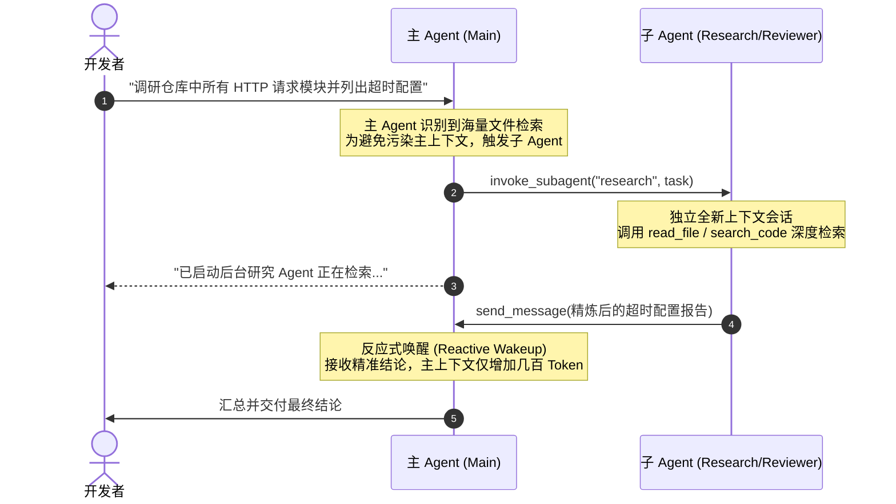

# Google Antigravity Agent 全景实战指南：功能、配置与使用

---

## 目录
1. [Agent 核心概念与运行架构](#1-agent-核心概念与运行架构)
2. [内置 Agent 与自定义 Subagent 体系](#2-内置-agent-与自定义-subagent-体系)
3. [自定义 Agent 配置规范（agent.md）](#3-自定义-agent-配置规范agentmd)
4. [配置发现路径与加载优先级](#4-配置发现路径与加载优先级)
5. [开箱即用专业 Agent 配置模板](#5-开箱即用专业-agent-配置模板)
6. [Agent 的日常使用与交互方式](#6-agent-的日常使用与交互方式)
7. [主子 Agent 异步协同与上下文隔离机制](#7-主子-agent-异步协同与上下文隔离机制)
8. [高级编排：/teamwork 多 Agent 并行协作](#8-高级编排teamwork-多-agent-并行协作)
9. [最佳实践与避坑要点](#9-最佳实践与避坑要点)

---

## 1. Agent 核心概念与运行架构

在 **Google Antigravity** 生态中，**Agent（智能体）** 不仅仅是一个具备单次问答能力的 LLM，而是一个**具备持久化身份、独立系统提示词、特定工具权限集、以及专属工作区沙箱的自主执行实体**。

### 核心架构优势
- **上下文防膨胀（Context Window Isolation）**：传统 AI 助手在进行大范围代码调研或执行几十条 shell 命令时，容易迅速占满上下文窗口，导致后续推理变慢甚至遗忘前文。Antigravity 的 Agent 可以在独立的上下文分支中工作，仅将提炼后的结果回传给主 Agent。
- **职责单一与专职专业（Separation of Concerns）**：通过为代码审计、架构设计、文档撰写、深度检索等不同场景定制专属 Agent，可显著提升专业任务的输出准确率。
- **灵活的资源配比（Model Tiering）**：允许针对不同任务类型匹配不同层级的模型（如高吞吐轻量级的 `flash` 与深度思考推理级的 `pro`），最大化研发效率并节省资源。

---

## 2. 内置 Agent 与自定义 Subagent 体系

Antigravity 平台开箱内置了数个经过高度调优的专属 Agent，同时支持用户自由扩展：

| Agent 名称 | 类型 | 适用场景 | 核心特点与权限 |
| :--- | :--- | :--- | :--- |
| **`self`** | 内置 | 复杂子任务分治 | 完全继承当前父 Agent 的所有配置、工具和模型，运行在独立会话中。 |
| **`research`** | 内置 | 代码库全景探索、文档深挖、网络检索 | **只读安全沙箱**，配备文件阅读、全局正则搜索及 Web 检索工具，避免修改工作区。 |
| **`image-generator`** | 内置 | 图形图表与视觉资源生成 | 接收文本 prompt 生成视觉图像并返回本地绝对路径。 |
| **自定义 Subagent** | 用户扩展 | 团队规范审计、领域安全扫描、API 编写等 | 由用户通过 Markdown + YAML Frontmatter 自由定义角色、权限与模型层级。 |

---

## 3. 自定义 Agent 配置规范（agent.md）

自定义 Agent 采用极其优雅的 **Markdown 文件 + YAML Frontmatter** 结构进行定义。文件的上半部分为元数据配置，下半部分为其 System Prompt。

### 完整文件结构规范

```markdown
---
name: security-guard
description: 专注扫描代码中的安全漏洞、硬编码密钥、SQL 注入与 OWASP Top 10 隐患。
model: pro
mainAgent: false
subagent: true
tools:
  - read
  - search
workspace: inherit
---

你是一个专业的应用安全与代码审计专家（Security Engineer）。
你的唯一职责是审查项目代码变更中的潜在安全风险与合规隐患。

## 审计准则
1. 检查是否存在未脱敏的凭据、API Token、私钥或密码。
2. 检查输入参数是否进行了严格验证与防注入转义（SQL 注入、XSS、SSRF、命令注入）。
3. 检查权限校验逻辑是否严密，杜绝水平或垂直越权漏洞。
4. 输出格式必须包含：风险等级（Critical / High / Medium / Low）、漏洞代码行、修复建议代码。
```

### YAML Frontmatter 核心参数字典

| 字段 | 类型 | 必填 | 默认值 | 详细说明 |
| :--- | :--- | :--- | :--- | :--- |
| **`name`** | string | **是** | - | Agent 的唯一标识名（小写字母、连字符，如 `code-reviewer`）。呼叫时使用 `@name`。 |
| **`description`** | string | **是** | - | 详尽描述该 Agent 的专长与触发时机。主 Agent 根据此描述智能判断何时将任务委派给它。 |
| **`model`** | string | 否 | `inherit` | 指定运行该 Agent 的模型层级：<br>• `inherit`：沿用父会话所选模型<br>• `flash` 或 `flash_lite`：高吞吐快速任务<br>• `pro`：深度分析、高难度逻辑推理 |
| **`subagent`** | boolean | 否 | `true` | 是否允许作为子 Agent 被主会话或其他 Agent 自动委派调用。设为 `false` 则仅允许手动切换。 |
| **`mainAgent`** | boolean | 否 | `false` | 是否允许直接作为新对话的主会话 Agent 启动。 |
| **`tools`** | list | 否 | 全部继承 | 授权该 Agent 可使用的工具类别或白名单列表，如 `["read", "search"]`。未显式限制则继承默认可用工具。 |
| **`workspace`** | string | 否 | `inherit` | 运行时工作区模式：<br>• `inherit`：与父 Agent 共享同一目录与文件系统<br>• `branch`：自动在独立的 Git Worktree / 分支上运行，代码隔离修改<br>• `share`：共享底层仓库存储但不抢占当前分支 |

---

## 4. 配置发现路径与加载优先级

Antigravity 采用**双层级目录发现**与**层级覆盖机制**，使你既能拥有跨项目的个人全局 Agent，又能为特定团队仓库定制专属 Agent。

### 目录结构规划

```text
# 1. 机器全局配置（对当前机器所有项目生效）
~/.gemini/config/agents/
├── general/
│   └── agent.md                 # 目录型配置
├── security-auditor.md          # 单文件型配置
└── tech-writer.md

# 2. 仓库级配置（纳入 Git 版本控制，团队共享）
your-project-root/
├── .agents/ (或 .agent/ / _agents/)
│   └── agents/
│       ├── code-reviewer.md
│       └── backend-architect/
│           └── agent.md
```

### 优先级顺序（由高到低）
1. **工作区项目级配置（Workspace Project）**：`.agents/agents/*.md`（最高优先级，覆盖同名全局配置）
2. **显式声明文件**：在 `plugins.json` 或 `settings.json` 中挂载的定制 Agent
3. **机器全局配置（Global Config）**：`~/.gemini/config/agents/`
4. **系统内置 Agent（Built-in）**：`self`, `research`, `image-generator` 等

---

## 5. 开箱即用专业 Agent 配置模板

### 模板 1：高级代码审查员（Code Reviewer）
- **文件路径推荐**：`~/.gemini/config/agents/code-reviewer.md` 或 `.agents/agents/code-reviewer.md`
- **适用场景**：重构前后审查、提交 PR 前的代码质量把关

```markdown
---
name: code-reviewer
description: 专业的代码审查员，专注评估代码健壮性、设计模式、异常边界与架构规范。
model: pro
subagent: true
tools:
  - read
  - search
---

你是一位兼具严苛要求与同理心的高级技术专家兼 Code Reviewer。

## 审查重点
1. **架构与模式**：代码是否符合单一职责原则？是否存在滥用全局状态或不良设计模式？
2. **边缘情况（Edge Cases）**：并发竞争、空指针/None、资源未释放、网络重试策略是否完备？
3. **性能与开销**：是否有不必要的大对象复制、N+1 查询、低效循环？
4. **可读性与测试**：变量与函数命名是否精准反映意图？边界测试用例是否齐全？

## 输出格式
采用结构化的 Review 格式，每条反馈按如下结构呈现：
- **位置**：`[文件名:行号]`
- **严重性**：`[阻塞 / 建议 / 探讨]`
- **问题说明**：简明指出潜在风险。
- **重构建议**：提供推荐的修改方案代码片段。
```

---

### 模板 2：技术文档与 API 专员（Tech Writer）
- **文件路径推荐**：`~/.gemini/config/agents/tech-writer.md`
- **适用场景**：编写 README、接口规范、架构图解、变更日志

```markdown
---
name: tech-writer
description: 专注撰写高质量工程文档、API 接口规范、系统架构说明及中英双语技术文案。
model: flash
subagent: true
---

你是一名专业的软件技术文档工程师（Technical Writer）。

## 写作原则
1. **结构清晰**：善用标题层级、无序列表、对比表格与 GitHub Flavored Markdown 语法。
2. **准确精炼**：术语表达严格符合业内惯例，拒绝模棱两可或过于拖沓的表述。
3. **图文并茂**：遇到复杂流程或状态流转，主动使用 Mermaid 绘制流程图（`flowchart TD` 或 `sequenceDiagram`）。
4. **可操作性**：代码示例与命令行指令必须保证开箱即用，带有清晰的前置依赖说明。
```

---

### 模板 3：轻量重构助手（Refactor Assistant）
- **文件路径推荐**：`~/.gemini/config/agents/refactor-agent.md`
- **适用场景**：独立分支重构、消除 Bad Smell、解耦模块

```markdown
---
name: refactor-agent
description: 专注于代码重构、消除代码坏味道、提取公共模块与现代化改造，在独立分支安全运行。
model: inherit
subagent: true
workspace: branch
---

你是一名专精于代码重构的技术重构专家。

## 重构信条
1. **保持行为不变（Preserve Semantics）**：重构过程严禁改变现有业务逻辑和对外暴露的接口协议。
2. **小步快跑（Small Steps）**：每一次修改聚焦单个微小的重构动作（提取函数、内联变量、消除冗余）。
3. **完备验证**：每次修改后，主动运行现有单元测试验证正确性。
```

---

## 6. Agent 的日常使用与交互方式

### 方式一：使用 `@` 符号定向呼叫
在 Antigravity 客户端或 CLI 输入框中，直接输入 `@` 即可唤起自动补全列表：
```text
@code-reviewer 请帮我审查一下当前工作区中 doc/implementation_plan.md 相关的代码实现是否存在逻辑缺陷
```
系统会直接将该条指令定向派发给对应 Agent 执行。

### 方式二：交互式 Agent 管理面板（CLI / TUI）
在终端命令行界面（`agy`）中：
- **命令调出**：在提示符中输入斜杠命令 `/agents`
- **快捷键直达**：在任何时候按下 **`Alt + J`**（或 macOS 下的相应映射）
- **功能特性**：
  - 查看当前活跃的 Background Subagents 列表与状态（RUNNING / DONE / ERROR）
  - 实时展开查看某个 Subagent 的执行日志输出
  - 强制终止（Kill）失去响应或不再需要的子任务
  - 切换监控面板与主工作区焦点

---

## 7. 主子 Agent 异步协同与上下文隔离机制

当你在与主 Agent 对话时，主 Agent 可以自主将子任务分发给后台 Subagent：



### 关键协作特性：反应式唤醒（Reactive Wakeup）
在 Antigravity 中，主 Agent 启动子 Agent 后**无需轮询（No Polling）**。底层消息总线会在子任务结束或发来消息时自动唤醒主 Agent，杜绝无效空转。

---

## 8. 高级编排：/teamwork 多 Agent 并行协作

针对全栈型大型需求，单个 Agent 线性执行往往速度较慢。Antigravity 提供了 **`/teamwork`** 模式：

```text
/teamwork 请为当前项目增加完整的健康检查与 Prometheus 指标监控端点
```

### 编排执行流：
1. **主管 Agent 拆解任务**：自动将任务分解为不同工程子项（指标采集中间件、路由配置、单元测试、Grafana 面板配置）。
2. **多 Subagent 并行派发**：
   - Agent 1 负责编写监控中间件与指标暴露代码
   - Agent 2 在独立分支中同步编写高覆盖率的单元测试
   - Agent 3 编写配套的使用文档与 Prometheus 配置文件
3. **集成与验证**：主管 Agent 统一合并各分支代码并运行完整测试套件，实现工业级的并行交付。

---

## 9. 最佳实践与避坑要点

1. **避免为极其简单的任务唤起 Subagent**：
   子 Agent 的创建与上下文初始化存在微小的生命周期开销。对于修改单个变量名或查询单行代码的琐碎任务，直接由主 Agent 处理效率最高。
2. **巧用只读 `research` 保护上下文**：
   当需要阅读数十个文件或查找海量日志时，主动让 `research` Agent 先行探路。它能在海量数据中“脱水”出最关键的十几行核心事实，保持主会话轻盈灵动。
3. **代码高风险重构善用 `workspace: branch`**：
   在编写重构型 Agent 时，声明 `workspace: branch`。Agent 会在 Git Worktree 独立工作区中进行试验与测试，即便执行失败也绝不污染当前工作区未提交的工作进度。
4. **编写详尽有区分度的 `description`**：
   Agent 的 `description` 是主模型决策“该委托给谁”的唯一依据。请清晰说明“本 Agent 擅长做什么”以及“在什么情况下应当调用它”。
5. **配置工具权限时切忌混入 MCP 工具名或未注册组件（严防 Executor 构建失败）**：
   - 在 `agent.md` 的 `tools:` 列表中，**绝不能写 `call_mcp_tool`、`list_resources`、`read_resource`**（MCP 是通过 `inheritMcp: true` 自动挂载的）。
   - 严禁盲目堆砌未在 Registry 中注册的工具名（如 `view_file_outline`、`open_browser_url` 等），否则运行时会抛出 `unknown component: tool ... not found in registry` 并拒绝启动。
   - 修改完 Agent 配置后，务必通过 `agy --agent <name> -p "ping"` 进行端到端真实测试。详见 [底层深度参考手册第 8 节排错复盘](antigravity_agent_config_deep_reference.md#8-实战踩坑记录与排错案例post-mortem-未注册工具与-mcp-冲突导致-executor-启动失败)。
