# Antigravity 受控 Root 子代理（`root-admin`）安全架构与实施方案

## Goal Description

在当前环境中，Antigravity（[`/usr/local/bin/agy`](file:///usr/local/bin/agy)）以普通用户 `mickey`（`uid=1000`）运行，自身不具备 `root` 权限。同时，由于 Antigravity 的主 Agent 与子 Agent 共享同一个操作系统进程（`uid=1000`），如果简单为 `mickey` 配置无条件免密 `sudo`，会带来两大安全隐患：
1. **意外提权风险**：主 Agent 或普通子 Agent（如 `general`）在日常任务中可能直接调用 `sudo`，绕过子代理隔离边界。
2. **外部滥用风险**：当前用户下的任何第三方脚本、容器钩子或普通进程都可能直接调用免密 `sudo` 获取系统控制权。

本方案设计一套 **“四层纵深防御（Defense-in-Depth）受控提权子代理架构”**：
* **日常权限零暴露**：主 Agent 与通用子 Agent（[`general/agent.md`](file:///home/mickey/.gemini/config/agents/general/agent.md)）完全运行在普通用户权限下，无法直接提权。
* **专用子代理隔离**：新增仅可作为子代理调用的 `root-admin`（[`root-admin/agent.md`](file:///home/mickey/.gemini/config/agents/root-admin/agent.md)，使用 **Gemini 3.8 Flash** 模型层级）。
* **底层双重调用方鉴权（Caller Attestation）**：通过受控 Root 桥接器 `/usr/local/sbin/agy-root-exec` 强制校验 **Linux 进程树祖先链**（必须源自 `/usr/local/bin/agy`）与 **Antigravity 会话轨迹（Transcript Attestation）**（调用方传入的 `--subagent-id` 必须是由父会话通过 `TypeName: "root-admin"` 派生且尚未结束的活跃子代理会话），从代码层面 **100% 阻断主 Agent、普通子 Agent 或外部脚本的意外提权与滥用**。
* **高危黑名单拦截与独立审计**：内置防篡改/防毁盘高危黑名单，并将所有允许/拒绝的操作强制写入 `root` 独占的 `/var/log/agy-root-agent.log`。

---

## Architecture & Security Design

```mermaid
sequenceDiagram
    autonumber
    participant User as 用户 (mickey)
    participant Main as 主 Agent (uid=1000)
    participant Sub as root-admin 子代理 (Flash 3.8)
    participant Bridge as /usr/local/sbin/agy-root-exec (root)
    participant Log as /var/log/agy-root-agent.log (0600 root)

    User->>Main: 执行需要 root 权限的任务
    Note over Main: 全局 Rule 禁止主 Agent 直接调用 sudo
    Main->>Sub: invoke_subagent(TypeName="root-admin", Prompt=...)
    Note over Sub: 从 <user_information> 获取自身 Conversation ID
    Sub->>Bridge: sudo -n /usr/local/sbin/agy-root-exec --subagent-id <ID> --reason "..." -- <cmd>
    
    rect rgb(40, 45, 60)
    Note over Bridge: 防线 1：双重调用方鉴权 (Caller Attestation)
    Bridge->>Bridge: 1. 校验 /proc 进程链祖先是否包含 /usr/local/bin/agy
    Bridge->>Bridge: 2. 校验子代理 transcript.jsonl 首条为 SYSTEM_MESSAGE 及父会话 ID
    Bridge->>Bridge: 3. 校验父会话 transcript.jsonl 确系以 TypeName="root-admin" 派生该 ID 且未结束
    end

    rect rgb(60, 40, 45)
    Note over Bridge: 防线 2：高危命令与自篡改黑名单校验
    Bridge->>Bridge: 拦截 rm -rf /、mkfs、dd 写盘、改 sudoers/shadow/自身脚本、交互式提权 shell
    end

    Bridge->>Log: 写入不可篡改审计日志 (时间/会话ID/PID/原因/命令/结果)
    Bridge-->>Sub: 返回标准输出/标准错误与退出码
    Sub-->>Main: 汇总执行结果与审计摘要
    Main-->>User: 汇报任务结果
```



---

## User Review Required

> [!IMPORTANT]
> **首次安装 Root 桥接器需执行一次 `sudo` 初始化脚本**
> 由于当前 `agy` 会话没有 `root` 权限且 `sudo` 需要密码，方案实施时我将先在 `~/.gemini/config/agents/root-admin/` 下生成所有代码与一键安装脚本 [`install_root_bridge.sh`](file:///home/mickey/.gemini/config/agents/root-admin/install_root_bridge.sh)。
> 安装脚本会使用 `visudo -cf` 严格校验语法后，再将桥接脚本部署至 `/usr/local/sbin/agy-root-exec` 并写入 `/etc/sudoers.d/agy-root-agent`。

> [!NOTE]
> **顺带修复 `general` 子代理的命令与文件工具权限**
> 在本次调研 [`/usr/local/bin/agy`](file:///usr/local/bin/agy) 二进制的 `ParseAgentScriptItemFromMarkdown` 函数时发现：当 `agent.md` 未显式声明 `tools:` 列表时，Antigravity 默认仅挂载 6 个只读工具（`send_message`、`view_file`、`read_url_content`、`search_web`、`schedule`、`generate_image`），不含 `run_command` 和文件编辑工具。
> 因此本方案将同步更新 [`general/agent.md`](file:///home/mickey/.gemini/config/agents/general/agent.md)，为其显式开启普通用户级 `run_command` 与文件读写工具，使其成为真正的通用执行子代理（非 root），与 `root-admin`（专用特权子代理）职责互补。

---

## Proposed Changes

### 1. 受控 Root 提权桥接器与安装脚本

#### [NEW] [agy-root-exec.py](file:///home/mickey/.gemini/config/agents/root-admin/agy-root-exec.py)
将被安装至 `/usr/local/sbin/agy-root-exec`（属主 `root:root`，权限 `0755`）。核心安全逻辑如下：

```python
#!/usr/bin/env python3
"""
agy-root-exec: Antigravity Dedicated Subagent Privilege Escalation Bridge
Security layers:
  1. Process Lineage Check: Caller must be a descendant of /usr/local/bin/agy.
  2. Transcript Attestation: --subagent-id must be an active, uncompleted subagent
     spawned with TypeName == "root-admin" by its parent conversation.
  3. High-Risk Command Blacklist: Blocks destructive fs/disk ops, credential/sudoers
     tampering, SUID creation, and interactive shell escapes.
  4. Audit Logging & Timeout: Logs every attempt to /var/log/agy-root-agent.log
     and enforces non-interactive execution with timeout.
"""
```

**核心拦截与校验规则明细**：
1. **调用方身份核验（防意外提权 & 防外部滥用）**：
   * 遍历 `/proc/<pid>/status` 与 `/proc/<pid>/exe`，确认调用链祖先包含 `/usr/local/bin/agy`。
   * 检查 `/home/mickey/.gemini/antigravity-cli/brain/<subagent-id>/.system_generated/logs/transcript.jsonl`：
     * 文件修改时间距今不超过 `600` 秒（活跃窗口）。
     * 第 0 步（`step_index: 0`）必须为 `SYSTEM_MESSAGE`，并从中提取 `sender=<parent-id>`（主 Agent 自身的 `step_index: 0` 为 `USER_INPUT`，借此 100% 阻止主 Agent 冒充子代理调用）。
     * 在父会话 `<parent-id>` 的 `transcript.jsonl`（及 `transcript_full.jsonl`）中验证存在 `invoke_subagent` 调用，其参数包含 `root-admin` 且返回了该 `<subagent-id>`，同时父会话尚未收到该 `<subagent-id>` 的任务结束返回消息（单次委派生命周期绑定，结束后立即失效）。
2. **高危黑名单拦截（通用 Root + 破坏性拦截）**：
   * **禁止自篡改与权限配置修改**：拦截任何涉及 `/etc/sudoers`、`/etc/sudoers.d`、`/etc/shadow`、`/etc/gshadow`、`/etc/passwd`、`/etc/pam.d`、`/usr/local/sbin/agy-root-exec`、`/var/log/agy-root-agent.log` 的写入/删除/权限修改命令，以及 `visudo`、`passwd`、`chpasswd`、`usermod`、`chmod +s` / `chmod 4...`（SUID）。
   * **禁止毁盘与根目录破坏**：拦截 `rm -rf /`（及针对 `/boot`、`/etc`、`/usr`、`/var`、`/lib`、`/home` 顶层目录的递归删除）、`--no-preserve-root`、`mkfs*`、`wipefs`、`fdisk`、`parted`、`dd ... of=/dev/*`、`shred`。
   * **禁止停机与交互式逃逸**：拦截 `shutdown`、`reboot`、`poweroff`、`halt`、`init 0/6`、以及无命令参数的交互式 `su` / `bash -i` / `sh -i`。

---

#### [NEW] [install_root_bridge.sh](file:///home/mickey/.gemini/config/agents/root-admin/install_root_bridge.sh)
用于安全部署 Root 桥接器与 `sudoers.d` 配置的一键脚本：
1. 将 [`agy-root-exec.py`](file:///home/mickey/.gemini/config/agents/root-admin/agy-root-exec.py) 复制到 `/usr/local/sbin/agy-root-exec`，设置 `chown root:root` 和 `chmod 0755`。
2. 初始化 `/var/log/agy-root-agent.log`，设置 `chown root:root` 和 `chmod 0600`。
3. 生成临时 sudoers 文件并执行 `visudo -cf` 校验：
   ```text
   Defaults!/usr/local/sbin/agy-root-exec !requiretty, env_reset
   mickey ALL=(root) NOPASSWD: /usr/local/sbin/agy-root-exec
   ```
4. 校验通过后原子移动至 `/etc/sudoers.d/agy-root-agent`（权限 `0440`）。

---

### 2. Antigravity 子代理与全局安全规则配置

#### [NEW] [agent.md](file:///home/mickey/.gemini/config/agents/root-admin/agent.md)
创建专用受控 Root 子代理 `root-admin`：
```markdown
---
name: root-admin
description: 受控 Root 系统运维子 Agent（Gemini 3.8 Flash）。仅当任务遇到权限不足或明确需要 root 权限（如系统服务管理、挂载、系统级日志与容器底层检查、软件包维护）时委派调用。
mainAgent: false
subagent: true
model: flash
tools:
  - send_message
  - view_file
  - run_command
  - manage_task
---

你是一个受严格安全审计约束的 Linux Root 运维专家子 Agent（`root-admin`）。

### 核心提权执行规范（必须严格遵守）
1. **唯一合法的 Root 执行通道**：
   - 你所在的进程默认运行在普通用户下，禁止直接裸调 `sudo <cmd>`（会被系统拒绝）。
   - 任何需要 root 权限的命令，**必须**从你的 `<user_information>` 中读取当前的 `Conversation ID`，并通过受控桥接器执行：
     ```bash
     sudo -n /usr/local/sbin/agy-root-exec --subagent-id "<你的Conversation_ID>" --reason "<简明执行原因>" -- bash -c '<要执行的命令>'
     ```
2. **最小权限与三步变更原则**：
   - **能不用 root 就不用 root**：普通只读查看如果无需特权，优先用 `view_file` 或普通命令。
   - **先检查、后变更、再验证**：执行任何系统修改前，先用只读命令确认当前状态；执行最小化变更后，立即验证服务或配置状态。
3. **安全红线**：
   - 严禁尝试绕过 `/usr/local/sbin/agy-root-exec` 的安全限制，严禁修改 `/etc/sudoers*`、`/etc/shadow` 或桥接脚本自身。
   - 每次任务完成返回给主 Agent 时，必须附上本次通过 `agy-root-exec` 执行过的完整命令清单与退出状态。
```

---

#### [NEW] [privilege-separation.md](file:///home/mickey/.gemini/config/rules/privilege-separation.md)
创建全局规则，防止主 Agent 或其它子 Agent 意外提权尝试：
```markdown
---
description: 强制执行主 Agent 与 Root 特权子代理 (root-admin) 的权限分离规范，防止意外提权或越权调用。
---

# 权限分离与特权委派规范 (Privilege Separation Rule)

1. **禁止非特权 Agent 直接提权**：
   - 主 Agent 以及除 `root-admin` 以外的所有子 Agent（如 `general`、`research`）**严禁**直接执行 `sudo`、`su`、`pkexec` 或直接调用 `/usr/local/sbin/agy-root-exec`。
2. **按需委派给 `root-admin`**：
   - 当执行任务遇到 `Permission denied` 或明确需要 `root` 权限时，主 Agent 必须使用 `invoke_subagent` 将需要特权的具体子任务委派给 `TypeName: "root-admin"`（`Model: "flash"`）。
   - 委派给 `root-admin` 的指令必须范围明确、最小化，不得将无需 root 权限的大段普通开发任务一并交给 `root-admin`。
```

---

#### [MODIFY] [agent.md](file:///home/mickey/.gemini/config/agents/general/agent.md)
为通用子代理 `general` 显式声明完整工具列表（运行于非 root 普通权限下），解决默认缺少 `run_command` 和文件编辑工具的问题：
```diff
 mainAgent: true
 subagent: true
 model: flash
+tools:
+  - send_message
+  - view_file
+  - read_url_content
+  - search_web
+  - schedule
+  - generate_image
+  - replace_file_content
+  - multi_replace_file_content
+  - write_to_file
+  - notebook_edit
+  - run_command
+  - manage_task
 ---
```

---

## Verification Plan

### Automated & Security Boundary Tests
在完成部署后，我们将依次执行以下 4 项安全与功能验证：

1. **Agent 注册验证**：
   ```bash
   agy agents
   ```
   确认 `general` 与 `root-admin` 均被正确加载识别。

2. **防意外提权拦截测试（Negative Test 1 — 主 Agent / 普通 Shell 直接调用拦截）**：
   在主 Agent 中直接通过 `run_command` 尝试调用：
   ```bash
   sudo -n /usr/local/sbin/agy-root-exec --subagent-id "<主Agent_ID>" --reason "test direct call" -- id
   ```
   **预期结果**：桥接器检测到传入的 ID 为主 Agent 而非 `root-admin` 子代理，**拒绝执行并返回鉴权失败（Exit Code != 0）**。

3. **防高危命令拦截测试（Negative Test 2 — 黑名单验证）**：
   验证高危命令（如模拟修改 `/etc/sudoers` 或 `rm -rf /`）会被桥接器黑名单规则直接拦截并记录 `DENY` 审计日志。

4. **正向委派功能测试（Positive Test — 委派 `root-admin` 执行真实 Root 任务）**：
   通过 `invoke_subagent(TypeName="root-admin")` 委派一个需要 `root` 权限的只读检查任务（例如：检查之前普通用户报 `Permission denied` 的 `/var/lib/containers/storage/overlay` 目录占用，并读取 `/var/log/agy-root-agent.log` 的最新审计记录）。
   **预期结果**：`root-admin` 成功通过鉴权获取 `uid=0(root)` 执行结果，且审计日志完整记录该次调用。
